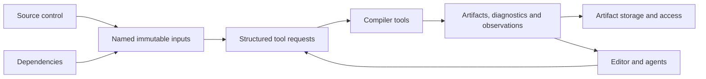

# Platform direction

Gaia is an effort to make software creation faster and easier to understand through explicit interfaces between tools. Source control is one piece; dependencies, compiler execution, editing and artifact access have their own responsibilities.

Native implementations use Odin. Linux on the available developer laptop is the first target. Keep platform-specific mechanisms behind interfaces so macOS, Windows and BSD support remain possible. A person should be able to work alone, offline, without registering an account or administering infrastructure. A lightweight CLI-managed local service is compatible with that goal.

## The working idea

An editor or source-control engine can already know which content changed. A dependency system can identify an immutable set of inputs. A compiler should be able to consume those inputs directly and return artifacts, diagnostics and the inputs it observed. Passing that knowledge explicitly may avoid rediscovering it through directories, timestamps and repeated subprocesses.

This is a direction, not an agreed universal object model. Logical names and identities should be separate from storage offsets, host paths and process-local pointers. Data can share storage or transport where contracts match; it need not share every schema or lifecycle rule.

## Responsibilities

| Component | Owns or explores |
| --- | --- |
| [Source control](../components/source-control/README.md) | Source snapshots, drafts/stacks, review records, safe updates, landing and recovery. |
| [Dependencies](../components/dependencies/README.md) | Ecosystem interpretation, version selection, content admission and loading/access. |
| [Compiler tools](../components/compiler/README.md) | Explicit invocation, execution budgets, diagnostics, observed inputs and result reuse. |
| [Editor](../components/editor/README.md) | Human/agent interaction with working content and tool results; design remains open. |
| [Artifact host](../components/artifact-host/README.md) | Local/remote content access, identity, retention and delivery; design remains open. |

Source control can record external verification without becoming a CI executor. Review metadata stays separate from the source read path. Compiler execution belongs in the broader tooling effort. Editor and artifact-host questions should not silently become source-control MVP requirements.

## Compatibility and open interfaces

Existing ecosystems must remain usable. Git interchange is a source-control adapter, existing package formats are dependency inputs, and filesystem/CLI materialization can support unchanged tools. Charge the conversion and materialization costs when assessing a workflow.

Potential shared contracts include named input sets, bulk access, toolchain/configuration identities, request lifetimes, artifacts, diagnostics and observed dependencies. Specify their behavior, error cases and lifetimes before choosing an encoding or transport. In-process, IPC and remote implementations may use different mechanisms with compatible semantics.

Experimental iteration can move quickly. Once a data contract is stabilized, incompatible changes need explicit version/capability handling. Independent readers and test vectors should be possible. No current experiment format or LLVM-specific adapter is a standard.

## What the measurements suggest

The strongest compiler gains came from avoiding repeated work: reusable processes, better dispatch order and correctly scoped object reuse. Removing object-file traffic alone did little on the tested C libraries. Selective dependency validation helped low-fanout header edits but added overhead to unchanged work. Python experiments similarly separated container access from interpreter/framework work.

Read [the findings](../research/findings.md) for the evidence and [the prospects](../research/prospects.md) for the next questions. Effects are specific to their workloads and timing boundaries; a warm page cache is not cold storage, and an admitted-input consumer time does not include initial SDK discovery.

The accepted source-control contracts live in its [design](../components/source-control/design.md).
