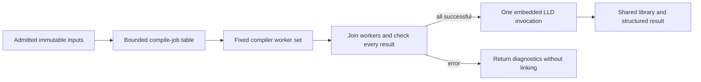

# Programmatic compiler invocation experiment

For human review, start with the [research page](../../research/compiler/README.md). This is an independent native compiler track, not part of the Python dependency-format or resolution results.

The fixture compiles real freestanding C objects using Clang/LLVM 22.1.8 at `-O2` for Linux x86-64. It compares ordinary CLI (one command for the whole source set), an Odin host calling Clang in process with physical inputs, and that host using one authenticated mmap-backed input collection through LLVM's in-memory VFS. Both one and eight translation units include either 32 or 512 generated headers. Native code uses Odin; [bridge.cpp](bridge.cpp) isolates Clang's C++ API behind a C ABI. ToolInvocation still parses its argument vector for every request; there is no precomputed compiler invocation, AST/PCH/result cache or hidden warm worker.

## Reproduce

```sh
python3 -B experiments/compiler/benchmark.py
```

Default: 15 randomized fresh processes for each of 12 cases, 180 observations, after object/link/execution warmups and boundary checks. For a smoke run:

```sh
python3 -B experiments/compiler/benchmark.py --headers 8 --trials 1 --output /tmp/gaia-compiler-smoke
```

The driver builds the adapter before timing, creates the fixtures, compares object hashes on every observation, and links/executes every mode/case warmup against independent expected values. Benchmark process clocks include startup, mapping/authentication, object generation/writes, per-request state disposal and process exit. Build/fixture production/linking/result validation are separate costs. No CPU-heavy work should run alongside measurements. Cache state is warm; no cache eviction or privileged tuning occurs.

Select LLVM with `--llvm` or `GAIA_LLVM`, and matching development headers with `--llvm-headers` or `GAIA_LLVM_HEADERS`. Odin comes from `PATH` or `ODIN`. See the [reproduction guide](../reproducing.md) for setup and experiment order. The bridge targets Clang/LLVM/LLD 22's API and Linux x86-64 shared libraries; other versions/layouts require adaptation and validation. A `--host` option reuses a binary built on your machine and records its hash.

Acquire matching development packages using your platform's package workflow. The benchmark does not download or install toolchains. Acquisition is outside consumer time; native builds, downloaded inputs and traces belong in ignored work directories.

New outputs and downstream input defaults use `_work/runs/`. Links below point to published evidence, whose recorded commands are observations from the original machine.

## Validation and measurement boundaries

- Every timed object must match the CLI control byte for byte. Each warmup is linked and every generated function executes with the independent expected result.
- Missing headers and invalid C must produce failure plus error diagnostics; wrong pins, truncated records and unsafe names must be rejected. Memory mode must work when the physical input directory is temporarily unavailable, and a missing virtual header must fail even when its physical copy exists.
- The mapped collection has magic/version, count, little-endian name/payload lengths and NUL-terminated names/payloads. Flat names and bounds are checked after a full SHA-256 pin check, with a 64 MiB input cap and 100,000-record cap. The LLVM buffer wrappers borrow payload bytes until all compiler/VFS objects are destroyed, before Odin unmaps the collection. Metadata allocation is not arena-bounded and this is not a portable format proposal.
- CLI defaults can leave some memory reclamation to process exit. The in-process path frees each request; Clang ToolInvocation already clears DisableFree, and the action explicitly preserves that setting. The [matching upstream implementation](https://github.com/llvm/llvm-project/blob/llvmorg-22.1.8/clang/lib/Tooling/Tooling.cpp) documents that behavior. The reusable host does not skip disposal to match a one-shot process.
- Child CPU comes from child rusage deltas, including descendants. RSS is not reported as a misleading cumulative parent-child maximum. Native clocks separate mount/setup, compilation and VFS disposal; compilation includes request construction and destruction. Whole-process clocks remain decisive.

## Separate syscall diagnostics

After timing completes, on a host that permits ptrace:

```sh
python3 -B experiments/compiler/trace_inputs.py
```

This replays six eight-TU commands, validates the resulting object hashes, and adds input/bundle-path syscall counts to the saved report. It does not change timing samples. In restricted environments ptrace may require a separate permission; ordinary benchmarks do not. Raw traces remain local under `_work`. Source reads/metadata probes are distinguished from runtime-library and object-output activity.

Results are in [REPORT.md](results/initial/REPORT.md) and results.json (local artifact, `results/initial/results.json`). Source/binary/fixture pins, compiler versions, build and consumer commands, producer costs, per-process CPU/fault counts, diagnostics and object hashes are retained. Saved commands require their local `_work` inputs. Regenerate from the fixture producer when those are absent.

## Real project: zlib

The [zlib report](results/zlib/REPORT.md) and raw observations (local artifact, `results/zlib/results.json`) extend this to the complete zlib 1.3.2 static library, with real system headers and upstream tests. The [project driver](project_benchmark.py) owns zlib acquisition/configuration/validation; [project_host.odin](project_host.odin) and [project_bridge.cpp](project_bridge.cpp) accept generic request vectors and absolute named inputs without zlib-specific native logic. The synthetic interfaces and formats remain supported separately.

Acquire the source archive into `_work/downloads/zlib-1.3.2.tar.gz` from [the upstream fossil archive](https://zlib.net/fossils/zlib-1.3.2.tar.gz). The driver requires SHA-256 `bb329a0a2cd0274d05519d61c667c062e06990d72e125ee2dfa8de64f0119d16`, as published on the [zlib home page](https://zlib.net/), before extraction. It does not download, install or modify system packages.

```sh
python3 -B experiments/compiler/project_benchmark.py
```

Default: 15 randomized blocks across upstream `make -j1`, `make -j8` (up to the available CPU count), one Clang batch command, sequential in-process physical input, and sequential in-process mapped input. Each observation rebuilds all 15 objects and the static archive. Artifact validation is outside the full library-build clock. Every timed artifact must match the CLI reference byte for byte. Each mode's warmup additionally passes upstream `make check`, including normal/64-bit example and gzip pipelines; retained [check summaries/logs](results/zlib/upstream-tests.json) verify the tested library was not rebuilt.

For a smoke run, use `--trials 1 --output /tmp/gaia-zlib-smoke`. Override `--archive`, `--llvm`, `--llvm-headers`, `--jobs`, `--trials` or `--output`. Configuration, dependency discovery, input admission and native adapter compilation happen before timing and are reported separately. Clang include search is made explicit with `-nostdinc` plus the discovered normal system/resource include directories for every control, while retaining configured project flags and generated headers. The adapter's memory VFS receives the project headers plus complete observed system-header closure; no real-filesystem input fallback is installed. All target flags and archive member order are fixed.

The absolute-input collection is experimental `GAIACIN2`, distinct from the flat synthetic `GAIACIN1`. Canonical absolute names reject empty/dot/parent components, backslashes and duplicates; payloads borrow the mapping until compiler/VFS disposal. `GAIACRQ1` supplies bounded per-request argument vectors. It is trusted local invocation configuration, just as CLI arguments are caller supplied; it has a retained identity hash but is not consumer-authenticated or a standardized wire protocol. All admitted input bytes are SHA-pinned. The selected system-header closure is tied to this compiler/target/configuration; another configuration requires readmission. Observed headers alone are not a general solution for every optional-header probe or generated-file behavior.

The boundary checks reject pin mismatch, rehashed truncation, unsafe names, truncated plans, and missing project/system headers despite their physical availability. A complete mapped build must also succeed when the physical project tree is temporarily unavailable. The default result has no PCH/AST cache, dependency-result reuse, native parallelism or persistent server. Parallel upstream make is a separate wall-time/CPU comparator, not an equal-concurrency measurement.

To collect three separate compilation traces after timing, where ptrace is permitted:

```sh
python3 -B experiments/compiler/trace_project_inputs.py
```

This preserves timed samples and validates all artifacts again. It classifies admitted project and system-header paths separately from the bundle, runtime files and outputs. The [real-project findings](FINDINGS.md#real-project-zlib) explain the effect size and the parallel-build limit.

## Bounded compiler queue and embedded linker

[pool_host.odin](pool_host.odin) owns a fixed worker set and atomic next-job queue over the bounded admitted request table (at most 64 jobs; 1–16 workers). [pool_bridge.cpp](pool_bridge.cpp) supplies worker-private VFS metadata, per-job Clang compiler/LLVM context and diagnostics, and the embedded LLD stage. Payload mappings and argument vectors are shared read-only. Compiler state is disposed after each request; worker-local VFS metadata lasts for that worker's queue lifetime. No compiler or linker subprocess is used on the internal path.



This stage builds an actual shared ELF library (`libz.so`), rather than the previous static archive (`libz.a`). The controls therefore also compile the 15 objects and link the same shared library with the same LLD command. Object order is the declared dependency order, never completion order. Objects still go through ordinary files; this is not direct object-buffer handoff or a link-input memory format. LLD input reads and output publication remain filesystem based. Its internal thread count is fixed to one for this comparison; linking starts only after all compiler workers join, so nested concurrency does not exceed the compile-pool bound.

```sh
python3 -B experiments/compiler/pool_benchmark.py
```

The default reuses freshly generated inputs from `_work/runs/zlib/results.json`, builds the new adapter, then measures 15 randomized blocks across make with one/eight jobs, mapped pools with one/two/four/eight workers, eight-worker physical input, and eight-worker mapped input with an external linker. `--workers`, `--jobs`, `--trials`, `--inputs`, `--host` and `--output` select controls/reproduction paths. A smoke command is:

```sh
python3 -B experiments/compiler/pool_benchmark.py --workers 1 8 --trials 1 --output /tmp/gaia-pool-link-smoke
```

The external-link control uses the same pool host linked against LLD but leaves linking to a separate process. This separates the call path from differences in compiler orchestration. Whole-build wall and aggregate child CPU include compilation and linking through normal process exit. Native phase clocks and per-job intervals remain diagnostic boundaries; every timed object/shared-library hash must match the make/CLI reference. Every mode's warmup runs upstream normal/64-bit tests against the shared library, and hashes verify no library replacement during validation.

Native peak RSS is per-process Linux VmHWM, including loaded compiler/linker libraries and all worker threads. It is not comparable with a cumulative child-process maximum, so make's aggregate peak RSS is not reported. Worker count bounds simultaneous frontends, not their byte usage. Compile failures stop new dispatch, allow in-flight work to finish, join workers and suppress linking; a prior published output is preserved in the failure check. Diagnostics are job-local and update Clang's diagnostic error state as well as the structured counters.

LLD exposes an [embedding entry point](https://lld.llvm.org/#features); this experiment uses its versioned `lldMain` interface and checks `canRunAgain`. Link calls are serialized because the installed linker has process-global context. The tests exercise ordinary link failure followed by success in the same process; unrecoverable LLD state retires the process. A compiler crash can still terminate the shared host: arbitrary toolchain crash isolation and a long-lived multi-build daemon are outside this prototype. Threaded compilation is validated for this pinned configuration, not every Clang option/plugin combination.

See the [pool/link report](results/pool-link/REPORT.md), raw data (local artifact, `results/pool-link/results.json`), and [findings](FINDINGS.md#bounded-compiler-queue-and-embedded-linker). These measurements have a different output/timing boundary from the static-library run; compare the controls inside this run.

## Direct object-buffer handoff

[handoff_host.odin](handoff_host.odin) retains the Odin worker queue and serialized linker lifecycle. [handoff_bridge.cpp](handoff_bridge.cpp) enables a conditional extension to the pool bridge; [handoff_impl.h](handoff_impl.h) captures Clang object output and supplies borrowed buffers to LLD. Normal pool builds do not enable this extension.

```sh
python3 -B experiments/compiler/handoff_benchmark.py
```

This reuses the admitted zlib inputs and prior object/shared-library identities. Defaults measure 15 randomized blocks across eight configurations: eight-job make, physical-input file/buffer-file/direct pools with eight workers, physical file/direct pools with one worker, and mapped-input file/direct pools with eight workers. All native controls use the same binary. Use `--trials 1 --output /tmp/gaia-handoff-smoke` for a smoke run; `--host` reuses a built adapter. Regenerate the earlier project/pool fixtures first if their ignored `_work` inputs are unavailable.

The native CLI extends the pool command with one final argument: `file`, `buffer-file`, `direct`, or validation-only `direct-export`. File uses ordinary Clang output. Buffer-file captures output then writes it before LLD reads it. Direct retains the native payloads through linking and creates no object files or memfd descriptors. Direct-export exports objects **after** linking so upstream `make check` can validate existing artifacts; timed direct builds never export. The final shared library still uses the filesystem. Object hashes are computed inside captured-mode processes after the native workload clock, adding a small validation cost to their complete process times; file-mode hashes are checked outside that clock.

Clang's [object action](https://github.com/llvm/llvm-project/blob/llvmorg-22.1.8/clang/lib/CodeGen/CodeGenAction.cpp) accepts the output stream provided through CompilerInstance. The installed LLD embedding entry point accepts filename arguments. This prototype interposes the public LLVM `MemoryBuffer::getFile` factory from the Linux executable while embedded linking is active. LLD's [ordinary readFile implementation](https://github.com/llvm/llvm-project/blob/llvmorg-22.1.8/lld/ELF/InputFiles.cpp) still performs its dependency/input ownership bookkeeping. Each wrapper borrows an object payload; the pool owns the payload until LLD's context has been destroyed. Compilation is quiescent and link calls are serialized. Other factory calls delegate to the original LLVM library; missing object names during linking fail instead of opening stale files.

This adapter is pinned to Linux and LLVM 22.1.8's exported ABI, not an upstream supported object-provider extension or portable protocol. It exercises LLD's binary, nonvolatile, unaligned-default input requests; general text/alignment factory semantics are not implemented for substituted objects. Names must match declared absolute paths or unique basenames. Compiler/linker state and object buffers are normally disposed; worker/job counts are bounded, but buffer bytes have no hard allocation cap. Native payloads still contain ELF objects: serialization and LLD parsing remain.

After timing, an optional separate trace verifies object I/O:

```sh
python3 -B experiments/compiler/trace_handoff.py
```

This needs ptrace permission and preserves all timed samples. `--analyze-only` reclassifies retained traces without rerunning tools. It distinguishes generated objects (including Clang's temporary `.o.tmp` files) from unrelated toolchain `crtbegin.o` discovery probes. The direct trace contains zero generated-object filesystem calls; toolchain probes, source inputs, runtime libraries and final output still use POSIX. See the [report](results/direct-handoff/REPORT.md), raw measurements (local artifact, `results/direct-handoff/results.json`), [trace summary](results/direct-handoff/object-io-traces.json), and [findings](FINDINGS.md#direct-object-buffer-handoff).

## Larger project and compiler lifetime follow-up

[zstd_handoff_benchmark.py](zstd_handoff_benchmark.py) extends the same handoff adapter to Zstandard 1.5.7's 30-unit dynamic library. Download the [official source archive](https://github.com/meta/zstd/releases/download/v1.5.7/zstd-1.5.7.tar.gz) and check it against the [upstream checksum](https://github.com/meta/zstd/releases/download/v1.5.7/zstd-1.5.7.tar.gz.sha256): `eb33e51f49a15e023950cd7825ca74a4a2b43db8354825ac24fc1b7ee09e6fa3`. Store it under `_work/downloads/` and extract it under `_work/zstd-source/`. The driver does not download or install anything. Downloaded sources retain their upstream licenses and remain ignored local fixtures.

```sh
python3 -B experiments/compiler/zstd_handoff_benchmark.py
```

Use `--source`, `--host`, `--trials`, and `--output` to change local locations or trial count. The default host comes from your completed direct-handoff run; `--host` selects another adapter built on your machine. The driver admits the commands from upstream `make -n`, with legacy compatibility off and upstream `ZSTD_NO_ASM=1` selecting the portable C configuration. It removes dependency-file production and preserves upstream `-O3` compiler flags. The debug configuration adds `-g` and an explicit shared `-fdebug-compilation-dir` so separate control output directories do not introduce debug-byte differences. The CLI control's generated makefile executes those same commands and the same ordered external LLD request. This measures the library target, not the whole repository or upstream build-configuration overhead.

Seven randomized blocks cover release/debug × CLI/file/direct with eight workers. Every object and shared ELF must match the corresponding CLI reference. Every mode's warmup additionally runs upstream simple/streaming examples on empty, small and 1 MiB data, checking loader resolution and decompressed bytes. This is a focused public-API validation, not the upstream full fuzzer suite. Object volume, native phase times, whole-process time, CPU and native RSS are retained. [Report](results/zstd-handoff/REPORT.md), raw data (local artifact, `results/zstd-handoff/results.json`).

[lifecycle_host.odin](lifecycle_host.odin) is a separate driver for repeated complete builds in one process. It recreates the pool, worker threads, per-job compiler state, objects and linker context each iteration, and disposes them normally. It reuses loaded libraries and process-global initialization; it has no AST or completed-artifact cache. A final optional repeat count (1–32) extends the handoff CLI. Its JSON lines mark main entry/exit and pool disposal alongside every complete build result. [lifecycle_bridge.cpp](lifecycle_bridge.cpp) adds only a monotonic-clock query to the normal adapter.

[profile_bridge.cpp](profile_bridge.cpp) enables the conditional LLVM time-trace hooks in the pool bridge. Each compiler worker records its own trace and finishes it before main-thread aggregation; the trace is written only after compiler/linker work. Profiling is diagnostic only and never used for a latency control. Build these two variants through `benchmark.build`, using the same handoff linker libraries/export flag, with bridge/host pairs `lifecycle_bridge.cpp`/`lifecycle_host.odin` and `profile_bridge.cpp`/`handoff_host.odin`. The retained lifecycle results (local artifact, `results/compiler-lifecycle/results.json`) include exact build commands and pins. The convenience builder below creates fresh hosts under `_work/followup-hosts/`:

```sh
python3 -B experiments/compiler/build_followup_hosts.py
python3 -B experiments/compiler/lifecycle_benchmark.py
python3 -B experiments/compiler/profile_zstd.py
```

Run the timed experiments sequentially, then phase profiling. The lifecycle comparison uses seven randomized blocks of four complete builds per observation: four fresh processes versus one process doing four builds, independently for file/direct handoff. Per-build subprocess time excludes the parent's artifact checks between fresh processes; group time including checks is also retained. The observed launch-to-main and after-main intervals include scheduling and process observation, and are not pure loader/destructor CPU. Repeated builds are a finite batch, not a daemon, IPC protocol, or crash-isolation claim. [Lifecycle report](results/compiler-lifecycle/REPORT.md), [Zstandard phase report](results/zstd-handoff/PHASES.md).

## Cost-aware compiler dispatch

[schedule_host.odin](schedule_host.odin) adds dispatch priority to the same bounded queue, using the unchanged Clang/LLD handoff adapter. It keeps job/result indices and ordered linker arguments fixed. Each worker claims the next queue position and compiles that position's original job index. A caller may select FIFO or descending predicted cost; ties retain original order, and all-zero estimates fall back to FIFO. Unknown jobs have zero cost and sort after positive estimates. The sort is in Odin, bounded to 64 admitted jobs; this is not a scheduler for an unbounded build DAG. Worker count still limits concurrency rather than memory bytes.

```sh
python3 -B experiments/compiler/build_schedule_host.py
python3 -B experiments/compiler/schedule_benchmark.py
python3 -B experiments/compiler/check_schedule_failure.py
```

The builder uses the same LLVM/Odin dependencies and exported LLVM factory symbol as the handoff adapter. Existing measured binaries are preserved; use its `--work` option and the benchmark's `--host` option for another build location. The benchmark reuses the completed Zstandard fixture, plans, CLI reference identities and upstream example executables. Recreate the preceding Zstandard experiment first if its ignored `_work` artifacts are unavailable. `--inputs`, `--trials` and `--output` select the training dataset and output location.

The native CLI extends the handoff command with `fifo|cost COSTS`. The experimental `GAIACOST1` text table consists of that header token followed by one unsigned decimal nanosecond estimate per original job. It is limited to 4 KiB and must match the admitted job count. Both policies parse the same table before workers start; only dispatch order changes. Invalid headers, lengths and values fail admission. Cost records are trusted local scheduling hints, not authenticated source metadata or a standardized protocol. A wrong but valid hint can harm performance; it cannot change which commands or ordered link inputs execute. Callers must associate history with the correct source/toolchain/configuration identity; that association is recorded by the benchmark, not enforced by the text format.

Predictions are frozen medians from the seven earlier unprofiled file-handoff samples per configuration. They do not learn from this experiment's outcomes. The fixture measures release/debug × file/direct × FIFO/cost in seven randomized blocks, using one identical native binary. Every build recompiles all 30 objects and must match the prior CLI object/shared-library identities. Eight warmups additionally run the upstream examples through six byte-exact round trips each. The driver checks all-zero stable fallback and malformed records preserving existing output; the separate failure checker verifies a compile error in the highest-priority job suppresses linking and preserves a published library.

Reports retain whole-process wall time, aggregate CPU, compiler wall time, native peak RSS and original-index job intervals. Predicted-longest start is measured relative to the first job start; the final one-job tail is the gap between the last two completions. These are logical job spans, not CPU utilization. Starting heavy jobs earlier may increase contention, so the observed dispatch delay is not a guaranteed saving. Prediction preparation and the original training builds are outside consumer timing; no first-build prediction benefit or generalization across configurations is assumed. [Report](results/cost-scheduling/REPORT.md), raw observations (local artifact, `results/cost-scheduling/results.json`).

Current source accepts unpadded one-job cost tables. After building the scheduling host, run its focused boundary checks:

```sh
python3 -B experiments/compiler/check_schedule_small.py --host experiments/compiler/_work/schedule-development/build/host
```

The [findings](FINDINGS.md#cost-aware-compiler-dispatch) summarize effect size, CPU/memory tradeoffs, timing provenance and remaining scheduling work.

## Local compiled-object cache

[cache_host.odin](cache_host.odin) owns cache keys, entry validation, hit selection, publication and the bounded miss queue. [cache_bridge.cpp](cache_bridge.cpp) supplies three narrow compiler operations: install an explicit per-request VFS view, copy a validated hit into the captured-object pool, and expose successful native object bytes for storage. There is no compiler process on a hit and every build still links through the existing embedded LLD adapter. Worker/compiler state is created only for misses. The existing pool/handoff/scheduling drivers are unchanged.

```sh
python3 -B experiments/compiler/build_cache_host.py
python3 -B experiments/compiler/object_cache_benchmark.py
```

The builder accepts `--work`, `--llvm` and `--llvm-headers`. Existing binaries are preserved; pass a fresh build directory and select it with the benchmark's `--host` when rebuilding. The benchmark reuses the admitted Zstandard source configuration from `_work/runs/zstd-handoff/results.json`, then creates a separate source fixture. Defaults are five randomized blocks, eight workers, release `-O3`, and 31 jobs: the 30 library units plus one small observable invalidation probe. `--inputs`, `--trials`, `--host` and `--output` select other local run locations/counts. The producer constructs immutable collections, explicit include search and fresh independent CLI references before consumer timings. No dependencies are downloaded or installed.

The native CLI extends the handoff command with `off|whole|scoped CACHE VIEWS CONTEXT-ID`; it requires memory inputs, direct object handoff and internal linking. `GAIACV1` is a trusted local text manifest containing one unsigned 64-bit job-visibility mask per collection entry, in collection order. A bit declares that file visible to that compiler request. The compiler actually receives this view through an in-memory filesystem with no host fallback; these masks are not merely hints to the cache. The prototype retains its 64-job/16-worker/64-MiB-input bounds. Known C flags and explicit admitted toolchain/environment are part of the contract; this is not a drop-in cache for arbitrary Clang plugins, PGO data, response files or complete host SDK discovery.

All modes compile against the same views. The fixture declares all admitted project/SDK headers shared, source roots private to their request, and any observed cross-root includes visible to their consumers. Correct generic use requires the caller to supply a complete intended namespace, including optional-file visibility. This experiment checks equivalence to normal CLI outputs for its recorded configurations and edits; dependency discovery alone is not a general complete SDK model.

Scoped keys hash exact framed arguments, logical working directory, admitted toolchain/execution-context identity and a Merkle root of the complete visible namespace (names, lengths and content hashes). Whole keys also hash the complete admitted collection, deliberately over-invalidating other requests after an isolated source edit. File leaves are hashed once per consumer; roots combine metadata rather than rehashing shared payloads for every job. Both file presence and content matter. Timestamp-based identities and previous positive dependency reads alone are not used. Volatile date/time macros are rejected through a required compiler guard, and response-file arguments are rejected by admission.

The private local `GAIACO01` record contains an eight-byte magic, 32-byte key, 32-byte payload SHA-256, eight-byte little-endian size and the object bytes. Readers validate framing/key/hash and rebuild invalid entries. Payloads are copied into native object buffers before linking. Successful, diagnostic-free misses publish through exclusive temporary files and atomic rename after the complete build succeeds. Warning/remark-producing requests bypass storage so their messages recur on the next invocation. Cache write failures do not invalidate a successful build. Records provide corruption detection, not authentication of an untrusted writer; publication is atomic but not fsync-durable. Eviction, quotas, payload deduplication and long-lived service recovery remain open.

Each timed cache begins with only baseline entries. The driver restores that seed outside the consumer clock before **every** observation, so a variant built in one trial cannot become an all-hit variant in the next. Scenarios cover no edits, light/heavy implementation edits, shared/generated headers and global flags. An additional optional-header appearance check verifies namespace invalidation. Every object/shared-library hash must match the corresponding fresh CLI reference; runtime probes check that the edits actually changed behavior. Consumer clocks include admission hashing, lookup/key construction, miss compilation, linking, cache publication, result hashing and normal process exit. Producer discovery/snapshot construction, CLI references, baseline cache population and cache-reset preparation are recorded separately. The baseline is a full uncached batch, not an incremental make/ninja/ccache comparison.

After timings, run the independent boundary and upstream checks:

```sh
python3 -B experiments/compiler/check_object_cache.py --host experiments/compiler/_work/cache-development/build/host
python3 -B experiments/compiler/check_cache_upstream.py
```

Current source includes diagnostic-free-only publication. Build a fresh host with `build_cache_host.py` and use it for timing and boundary checks. The boundary checker creates a fresh seed for its host identity, tests corruption repair, context invalidation, write failure, failed compile publication, undeclared host files, invisible inputs, concurrent publication, warning repetition and volatile macro rejection. The upstream checker verifies actual loader resolution and six byte-exact example round trips against every final timed library and every CLI reference.

See the [report](results/object-cache/REPORT.md), raw observations (local artifact, `results/object-cache/results.json`), [boundary checks](results/object-cache/checks.json), [upstream checks](results/object-cache/upstream-checks.json), and [findings](FINDINGS.md#local-compiled-object-cache).

## Dependency journals and incremental snapshots

[dependency_host.odin](dependency_host.odin) adds observed-query validation to the local cache. [dependency_bridge.cpp](dependency_bridge.cpp) enables an optional hook in the cache adapter; [dependency_impl.h](dependency_impl.h) observes/replays the LLVM VFS boundary. Cache policy, candidate identity, record integrity and publication remain in Odin. Existing cache builds do not enable the journal hook.

```sh
python3 -B experiments/compiler/build_dependency_hosts.py
python3 -B experiments/compiler/dependency_cache_benchmark.py
python3 -B experiments/compiler/check_dependency_cache.py
python3 -B experiments/compiler/check_dependency_fanout.py
python3 -B experiments/compiler/check_cache_upstream.py --results experiments/compiler/_work/runs/dependency-cache/results.json
```

The builder accepts `--work`, `--llvm` and `--llvm-headers`, preserves existing binaries, and builds the consumer plus the independent Odin [snapshot producer](snapshot_host.odin). It uses object-mode Odin compilation and the pinned Clang linker driver, so Clang need not be available under an unversioned name on PATH. Benchmark options include `--inputs` (the completed previous object-cache fixture), `--host`, `--producer`, `--trials` and `--output`. Recreate earlier admitted fixtures when their ignored `_work` artifacts are unavailable. No source/toolchain downloads are performed.

The consumer keeps the same CLI and adds the `journal` policy. A candidate action ID binds exact argv, logical cwd and admitted execution context. It deliberately excludes the input snapshot root; finding a candidate is **not** sufficient for a hit. Its prior filesystem observations must all match against the new actual hermetic view before the object is imported. Content is hashed once per admitted file and reused across query checks. The journal retains query order, including cwd transitions. Every miss records fresh observations through the compiler's actual VFS, and only successful diagnostic-free results can publish.

The adapter supports status, existence, text/binary open, realpath, directory enumeration, locality and get/set cwd. Opened files bind content as well as observable metadata; failed lookups retain error outcomes. Directory enumeration binds the returned entry sequence. Numeric InMemoryFS IDs are normalized to canonical logical-path identity under this provider's contract: independent regular files and implicit directories, fixed metadata, no symlink/hardlink nodes. Unsupported/oversized observations bypass publication. The measured C workload exercises status/existence/open/cwd observations; this does not establish arbitrary plugin/module/filesystem compatibility or comprehensive coverage of every adapter operation.

`GAIAJR01` is a bounded query journal: magic, little-endian u32 count, then opcode/outcome bytes, u32 path length, path bytes and a 32-byte result fingerprint per observation. At most 65,536 queries, 4 KiB per query path and 16 MiB of serialized journal are accepted. `GAIADC01` atomically stores one candidate: eight-byte magic, 32-byte action ID, 32-byte checksum, u64 journal size, u64 object size, journal and object. The checksum binds the action, lengths, journal and object. Valid but changed observations are ordinary misses; invalid framing/checksums are corruption. One latest candidate is retained per action, so historical variants are not all preserved. Atomic replacement cannot mix journals and objects from concurrent writers. These are private local research records, not authenticated remote artifacts or a standardized protocol.

The snapshot producer accepts `full|delta BASE VIEWS DELTA OUT OUTVIEWS EXPECTED-PIN|- JOBS`. `GAIADP01` carries base collection/view SHA-256 values, an operation count and explicit put/remove records with path, visibility mask and payload. It validates framing, paths, bounds, base identities and the optional expected output pin before publication. Full refresh rereads every named file; delta mode applies supplied updates to the prior authenticated collection. Both emit the same sorted `GAIACIN2` collection and `GAIACV1` masks, hash the complete result and return a receipt only after publishing both outputs. The consumer is launched only after a successful receipt whose bundle/view pins match. This is a private pipeline handoff, not a crash-durable multi-file snapshot transaction or filesystem watcher. Both modes still serialize/hash the complete collection.

This experiment assumes a known admitted SDK/namespace and explicit change events. It does not rediscover arbitrary SDK dependencies after new compiler configurations. Changed-file discovery/event creation and initial admission are outside timing. The matched full-refresh control also has the previous namespace and the supplied membership changes; it is not a recursive directory scan or repeated `clang -M` measurement. A baseline-only cache is restored before every observation. Scenarios cover unchanged/source edits, used shared/generated headers, optional-header appearance, earlier include-path shadowing, an unused-header change and a newly appearing directory. Global flags remain part of action identity and invalidate all jobs in a separate check.

Timed header edits are low-fanout audit cases, consumed only by the probe. A separate real-project shared-header check uses independent CLI dependency discovery and an emitted marker to verify that every actual reader recompiles and each reader's object bytes change. Its result is a correctness check, not an additional timing comparison.

Five randomized blocks measure delta+off, delta+coarse scoped cache, delta+journal and full+journal. Combined timing includes the producer process, publication, receipt handoff, consumer admission/revalidation, misses/linking, cache publication/reporting and both normal process lifecycles. Parent correctness checks follow timing. Every object and ELF must match freshly rebuilt CLI references, and runtime probes verify the intended behavior. Separate checks inspect recorded negative queries; exercise deletion, reversion, corruption, same-action/different-input concurrent writers, reordered requests, diagnostic repetition and failed producer updates; and execute upstream examples against every final native/CLI library.

See the [report](results/dependency-cache/REPORT.md), raw data (local artifact, `results/dependency-cache/results.json`), [boundary checks](results/dependency-cache/checks.json), [upstream checks](results/dependency-cache/upstream-checks.json), and [findings](FINDINGS.md#dependency-journals-and-incremental-snapshots). Cold storage, arbitrary aliases/metadata, complete SDK admission, persistent workers, cache quotas/eviction and a portable observation protocol remain separate work.
