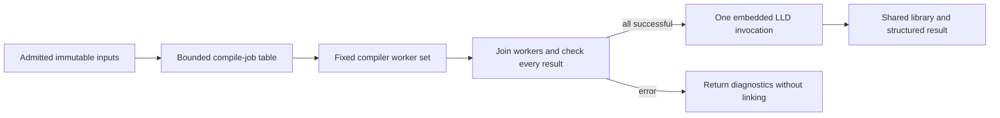

# Programmatic compiler invocation experiment

For human review, start with the [research page](../../research/compiler/README.md). This is an independent native compiler track, not part of the Python dependency-format or resolution results.

For a specific study, start with [semantic object reuse](semantic_invalidation/README.md), the [C++ graph](cpp_graph/README.md), or [logical workspace validation](#authoritative-logical-compiler-inputs). The sections below retain the original invocation, cache and producer reproduction chains. [Managed JVM compilers](../java/compiler/README.md) have separate code and clocks.

The [Ninja comparison](#ninja-incremental-build-comparison) measures actual incremental builds against Ninja and Ninja + ccache, including no-op/link skipping and input preparation.

The separate [C++ graph experiment](cpp_graph/README.md) extends this to upstream fmt and a labelled integration library/two executables. Its [baseline-seeded report](cpp_graph/results/baseline-seeded/REPORT.md) separates actual recompilation from repeated-edit object-history hits.

The fixture compiles real freestanding C objects using Clang/LLVM 22.1.8 at `-O2` for Linux x86-64. It compares ordinary CLI (one command for the whole source set), an Odin host calling Clang in process with physical inputs, and that host using one authenticated mmap-backed input collection through LLVM's in-memory VFS. Both one and eight translation units include either 32 or 512 generated headers. Native code uses Odin; [bridge.cpp](bridge.cpp) isolates Clang's C++ API behind a C ABI. ToolInvocation still parses its argument vector for every request; there is no precomputed compiler invocation, AST/PCH/result cache or hidden warm worker.

## Reproduce

```sh
python3 -B experiments/compiler/benchmark.py
```

Default: 15 randomized fresh processes for each of 12 cases, 180 observations, after object/link/execution warmups and boundary checks. For a smoke run:

```sh
python3 -B experiments/compiler/benchmark.py --headers 8 --trials 1 --output /tmp/gaia-compiler-smoke
```

The driver builds the adapter before timing, creates the fixtures, compares object hashes on every observation, and links/executes every mode/case warmup against independent expected values. Benchmark process clocks include startup, mapping/authentication, object generation/writes, per-request state disposal and process exit. Build/fixture production/linking/result validation are separate costs. No CPU-heavy work should run alongside measurements. Cache state is warm; no cache eviction or privileged tuning occurs.

Select LLVM with `--llvm` or `GAIA_LLVM`, and matching development headers with `--llvm-headers` or `GAIA_LLVM_HEADERS`. Odin comes from `PATH` or `ODIN`. See the [reproduction guide](../reproducing.md) for setup and experiment order. The bridge targets Clang/LLVM/LLD 22's API and Linux x86-64 shared libraries; other versions/layouts require adaptation and validation. A `--host` option reuses a binary built on your machine and records its hash.

Acquire matching development packages using your platform's package workflow. The benchmark does not download or install toolchains. Acquisition is outside consumer time; native builds, downloaded inputs and traces belong in ignored work directories.

New outputs and downstream input defaults use `_work/runs/`. Links below point to published evidence, whose recorded commands are observations from the original machine.

## Validation and measurement boundaries

- Every timed object must match the CLI control byte for byte. Each warmup is linked and every generated function executes with the independent expected result.
- Missing headers and invalid C must produce failure plus error diagnostics; wrong pins, truncated records and unsafe names must be rejected. Memory mode must work when the physical input directory is temporarily unavailable, and a missing virtual header must fail even when its physical copy exists.
- The mapped collection has magic/version, count, little-endian name/payload lengths and NUL-terminated names/payloads. Flat names and bounds are checked after a full SHA-256 pin check, with a 64 MiB input cap and 100,000-record cap. The LLVM buffer wrappers borrow payload bytes until all compiler/VFS objects are destroyed, before Odin unmaps the collection. Metadata allocation is not arena-bounded and this is not a portable format proposal.
- CLI defaults can leave some memory reclamation to process exit. The in-process path frees each request; Clang ToolInvocation already clears DisableFree, and the action explicitly preserves that setting. The [matching upstream implementation](https://github.com/llvm/llvm-project/blob/llvmorg-22.1.8/clang/lib/Tooling/Tooling.cpp) documents that behavior. The reusable host does not skip disposal to match a one-shot process.
- Child CPU comes from child rusage deltas, including descendants. RSS is not reported as a misleading cumulative parent-child maximum. Native clocks separate mount/setup, compilation and VFS disposal; compilation includes request construction and destruction. Whole-process clocks remain decisive.

## Separate syscall diagnostics

After timing completes, on a host that permits ptrace:

```sh
python3 -B experiments/compiler/trace_inputs.py
```

This replays six eight-TU commands, validates the resulting object hashes, and adds input/bundle-path syscall counts to the saved report. It does not change timing samples. In restricted environments ptrace may require a separate permission; ordinary benchmarks do not. Raw traces remain local under `_work`. Source reads/metadata probes are distinguished from runtime-library and object-output activity.

Results are in [REPORT.md](results/initial/REPORT.md) and results.json (local artifact, `results/initial/results.json`). Source/binary/fixture pins, compiler versions, build and consumer commands, producer costs, per-process CPU/fault counts, diagnostics and object hashes are retained. Saved commands require their local `_work` inputs. Regenerate from the fixture producer when those are absent.

## Real project: zlib

The [zlib report](results/zlib/REPORT.md) and raw observations (local artifact, `results/zlib/results.json`) extend this to the complete zlib 1.3.2 static library, with real system headers and upstream tests. The [project driver](project_benchmark.py) owns zlib acquisition/configuration/validation; [project_host.odin](project_host.odin) and [project_bridge.cpp](project_bridge.cpp) accept generic request vectors and absolute named inputs without zlib-specific native logic. The synthetic interfaces and formats remain supported separately.

Acquire the source archive into `_work/downloads/zlib-1.3.2.tar.gz` from [the upstream fossil archive](https://zlib.net/fossils/zlib-1.3.2.tar.gz). The driver requires SHA-256 `bb329a0a2cd0274d05519d61c667c062e06990d72e125ee2dfa8de64f0119d16`, as published on the [zlib home page](https://zlib.net/), before extraction. It does not download, install or modify system packages.

```sh
python3 -B experiments/compiler/project_benchmark.py
```

Default: 15 randomized blocks across upstream `make -j1`, `make -j8` (up to the available CPU count), one Clang batch command, sequential in-process physical input, and sequential in-process mapped input. Each observation rebuilds all 15 objects and the static archive. Artifact validation is outside the full library-build clock. Every timed artifact must match the CLI reference byte for byte. Each mode's warmup additionally passes upstream `make check`, including normal/64-bit example and gzip pipelines; retained [check summaries/logs](results/zlib/upstream-tests.json) verify the tested library was not rebuilt.

For a smoke run, use `--trials 1 --output /tmp/gaia-zlib-smoke`. Override `--archive`, `--llvm`, `--llvm-headers`, `--jobs`, `--trials` or `--output`. Configuration, dependency discovery, input admission and native adapter compilation happen before timing and are reported separately. Clang include search is made explicit with `-nostdinc` plus the discovered normal system/resource include directories for every control, while retaining configured project flags and generated headers. The adapter's memory VFS receives the project headers plus complete observed system-header closure; no real-filesystem input fallback is installed. All target flags and archive member order are fixed.

The absolute-input collection is experimental `GAIACIN2`, distinct from the flat synthetic `GAIACIN1`. Canonical absolute names reject empty/dot/parent components, backslashes and duplicates; payloads borrow the mapping until compiler/VFS disposal. `GAIACRQ1` supplies bounded per-request argument vectors. It is trusted local invocation configuration, just as CLI arguments are caller supplied; it has a retained identity hash but is not consumer-authenticated or a standardized wire protocol. All admitted input bytes are SHA-pinned. The selected system-header closure is tied to this compiler/target/configuration; another configuration requires readmission. Observed headers alone are not a general solution for every optional-header probe or generated-file behavior.

The boundary checks reject pin mismatch, rehashed truncation, unsafe names, truncated plans, and missing project/system headers despite their physical availability. A complete mapped build must also succeed when the physical project tree is temporarily unavailable. The default result has no PCH/AST cache, dependency-result reuse, native parallelism or persistent server. Parallel upstream make is a separate wall-time/CPU comparator, not an equal-concurrency measurement.

To collect three separate compilation traces after timing, where ptrace is permitted:

```sh
python3 -B experiments/compiler/trace_project_inputs.py
```

This preserves timed samples and validates all artifacts again. It classifies admitted project and system-header paths separately from the bundle, runtime files and outputs. The [real-project findings](FINDINGS.md#real-project-zlib) explain the effect size and the parallel-build limit.

## Bounded compiler queue and embedded linker

[pool_host.odin](pool_host.odin) owns a fixed worker set and atomic next-job queue over the bounded admitted request table (at most 64 jobs; 1–16 workers). [pool_bridge.cpp](pool_bridge.cpp) supplies worker-private VFS metadata, per-job Clang compiler/LLVM context and diagnostics, and the embedded LLD stage. Payload mappings and argument vectors are shared read-only. Compiler state is disposed after each request; worker-local VFS metadata lasts for that worker's queue lifetime. No compiler or linker subprocess is used on the internal path.



This stage builds an actual shared ELF library (`libz.so`), rather than the previous static archive (`libz.a`). The controls therefore also compile the 15 objects and link the same shared library with the same LLD command. Object order is the declared dependency order, never completion order. Objects still go through ordinary files; this is not direct object-buffer handoff or a link-input memory format. LLD input reads and output publication remain filesystem based. Its internal thread count is fixed to one for this comparison; linking starts only after all compiler workers join, so nested concurrency does not exceed the compile-pool bound.

```sh
python3 -B experiments/compiler/pool_benchmark.py
```

The default reuses freshly generated inputs from `_work/runs/zlib/results.json`, builds the new adapter, then measures 15 randomized blocks across make with one/eight jobs, mapped pools with one/two/four/eight workers, eight-worker physical input, and eight-worker mapped input with an external linker. `--workers`, `--jobs`, `--trials`, `--inputs`, `--host` and `--output` select controls/reproduction paths. A smoke command is:

```sh
python3 -B experiments/compiler/pool_benchmark.py --workers 1 8 --trials 1 --output /tmp/gaia-pool-link-smoke
```

The external-link control uses the same pool host linked against LLD but leaves linking to a separate process. This separates the call path from differences in compiler orchestration. Whole-build wall and aggregate child CPU include compilation and linking through normal process exit. Native phase clocks and per-job intervals remain diagnostic boundaries; every timed object/shared-library hash must match the make/CLI reference. Every mode's warmup runs upstream normal/64-bit tests against the shared library, and hashes verify no library replacement during validation.

Native peak RSS is per-process Linux VmHWM, including loaded compiler/linker libraries and all worker threads. It is not comparable with a cumulative child-process maximum, so make's aggregate peak RSS is not reported. Worker count bounds simultaneous frontends, not their byte usage. Compile failures stop new dispatch, allow in-flight work to finish, join workers and suppress linking; a prior published output is preserved in the failure check. Diagnostics are job-local and update Clang's diagnostic error state as well as the structured counters.

LLD exposes an [embedding entry point](https://lld.llvm.org/#features); this experiment uses its versioned `lldMain` interface and checks `canRunAgain`. Link calls are serialized because the installed linker has process-global context. The tests exercise ordinary link failure followed by success in the same process; unrecoverable LLD state retires the process. A compiler crash can still terminate the shared host: arbitrary toolchain crash isolation and a long-lived multi-build daemon are outside this prototype. Threaded compilation is validated for this pinned configuration, not every Clang option/plugin combination.

See the [pool/link report](results/pool-link/REPORT.md), raw data (local artifact, `results/pool-link/results.json`), and [findings](FINDINGS.md#bounded-compiler-queue-and-embedded-linker). These measurements have a different output/timing boundary from the static-library run; compare the controls inside this run.

## Direct object-buffer handoff

[handoff_host.odin](handoff_host.odin) retains the Odin worker queue and serialized linker lifecycle. [handoff_bridge.cpp](handoff_bridge.cpp) enables a conditional extension to the pool bridge; [handoff_impl.h](handoff_impl.h) captures Clang object output and supplies borrowed buffers to LLD. Normal pool builds do not enable this extension.

```sh
python3 -B experiments/compiler/handoff_benchmark.py
```

This reuses the admitted zlib inputs and prior object/shared-library identities. Defaults measure 15 randomized blocks across eight configurations: eight-job make, physical-input file/buffer-file/direct pools with eight workers, physical file/direct pools with one worker, and mapped-input file/direct pools with eight workers. All native controls use the same binary. Use `--trials 1 --output /tmp/gaia-handoff-smoke` for a smoke run; `--host` reuses a built adapter. Regenerate the earlier project/pool fixtures first if their ignored `_work` inputs are unavailable.

The native CLI extends the pool command with one final argument: `file`, `buffer-file`, `direct`, or validation-only `direct-export`. File uses ordinary Clang output. Buffer-file captures output then writes it before LLD reads it. Direct retains the native payloads through linking and creates no object files or memfd descriptors. Direct-export exports objects **after** linking so upstream `make check` can validate existing artifacts; timed direct builds never export. The final shared library still uses the filesystem. Object hashes are computed inside captured-mode processes after the native workload clock, adding a small validation cost to their complete process times; file-mode hashes are checked outside that clock.

Clang's [object action](https://github.com/llvm/llvm-project/blob/llvmorg-22.1.8/clang/lib/CodeGen/CodeGenAction.cpp) accepts the output stream provided through CompilerInstance. The installed LLD embedding entry point accepts filename arguments. This prototype interposes the public LLVM `MemoryBuffer::getFile` factory from the Linux executable while embedded linking is active. LLD's [ordinary readFile implementation](https://github.com/llvm/llvm-project/blob/llvmorg-22.1.8/lld/ELF/InputFiles.cpp) still performs its dependency/input ownership bookkeeping. Each wrapper borrows an object payload; the pool owns the payload until LLD's context has been destroyed. Compilation is quiescent and link calls are serialized. Other factory calls delegate to the original LLVM library; missing object names during linking fail instead of opening stale files.

This adapter is pinned to Linux and LLVM 22.1.8's exported ABI, not an upstream supported object-provider extension or portable protocol. It exercises LLD's binary, nonvolatile, unaligned-default input requests; general text/alignment factory semantics are not implemented for substituted objects. Names must match declared absolute paths or unique basenames. Compiler/linker state and object buffers are normally disposed; worker/job counts are bounded, but buffer bytes have no hard allocation cap. Native payloads still contain ELF objects: serialization and LLD parsing remain.

After timing, an optional separate trace verifies object I/O:

```sh
python3 -B experiments/compiler/trace_handoff.py
```

This needs ptrace permission and preserves all timed samples. `--analyze-only` reclassifies retained traces without rerunning tools. It distinguishes generated objects (including Clang's temporary `.o.tmp` files) from unrelated toolchain `crtbegin.o` discovery probes. The direct trace contains zero generated-object filesystem calls; toolchain probes, source inputs, runtime libraries and final output still use POSIX. See the [report](results/direct-handoff/REPORT.md), raw measurements (local artifact, `results/direct-handoff/results.json`), [trace summary](results/direct-handoff/object-io-traces.json), and [findings](FINDINGS.md#direct-object-buffer-handoff).

## Larger project and compiler lifetime follow-up

[zstd_handoff_benchmark.py](zstd_handoff_benchmark.py) extends the same handoff adapter to Zstandard 1.5.7's 30-unit dynamic library. Download the [official source archive](https://github.com/meta/zstd/releases/download/v1.5.7/zstd-1.5.7.tar.gz) and check it against the [upstream checksum](https://github.com/meta/zstd/releases/download/v1.5.7/zstd-1.5.7.tar.gz.sha256): `eb33e51f49a15e023950cd7825ca74a4a2b43db8354825ac24fc1b7ee09e6fa3`. Store it under `_work/downloads/` and extract it under `_work/zstd-source/`. The driver does not download or install anything. Downloaded sources retain their upstream licenses and remain ignored local fixtures.

```sh
python3 -B experiments/compiler/zstd_handoff_benchmark.py
```

Use `--source`, `--host`, `--trials`, and `--output` to change local locations or trial count. The default host comes from your completed direct-handoff run; `--host` selects another adapter built on your machine. The driver admits the commands from upstream `make -n`, with legacy compatibility off and upstream `ZSTD_NO_ASM=1` selecting the portable C configuration. It removes dependency-file production and preserves upstream `-O3` compiler flags. The debug configuration adds `-g` and an explicit shared `-fdebug-compilation-dir` so separate control output directories do not introduce debug-byte differences. The CLI control's generated makefile executes those same commands and the same ordered external LLD request. This measures the library target, not the whole repository or upstream build-configuration overhead.

Seven randomized blocks cover release/debug × CLI/file/direct with eight workers. Every object and shared ELF must match the corresponding CLI reference. Every mode's warmup additionally runs upstream simple/streaming examples on empty, small and 1 MiB data, checking loader resolution and decompressed bytes. This is a focused public-API validation, not the upstream full fuzzer suite. Object volume, native phase times, whole-process time, CPU and native RSS are retained. [Report](results/zstd-handoff/REPORT.md), raw data (local artifact, `results/zstd-handoff/results.json`).

[lifecycle_host.odin](lifecycle_host.odin) is a separate driver for repeated complete builds in one process. It recreates the pool, worker threads, per-job compiler state, objects and linker context each iteration, and disposes them normally. It reuses loaded libraries and process-global initialization; it has no AST or completed-artifact cache. A final optional repeat count (1–32) extends the handoff CLI. Its JSON lines mark main entry/exit and pool disposal alongside every complete build result. [lifecycle_bridge.cpp](lifecycle_bridge.cpp) adds only a monotonic-clock query to the normal adapter.

[profile_bridge.cpp](profile_bridge.cpp) enables the conditional LLVM time-trace hooks in the pool bridge. Each compiler worker records its own trace and finishes it before main-thread aggregation; the trace is written only after compiler/linker work. Profiling is diagnostic only and never used for a latency control. Build these two variants through `benchmark.build`, using the same handoff linker libraries/export flag, with bridge/host pairs `lifecycle_bridge.cpp`/`lifecycle_host.odin` and `profile_bridge.cpp`/`handoff_host.odin`. The retained lifecycle results (local artifact, `results/compiler-lifecycle/results.json`) include exact build commands and pins. The convenience builder below creates fresh hosts under `_work/followup-hosts/`:

```sh
python3 -B experiments/compiler/build_followup_hosts.py
python3 -B experiments/compiler/lifecycle_benchmark.py
python3 -B experiments/compiler/profile_zstd.py
```

Run the timed experiments sequentially, then phase profiling. The lifecycle comparison uses seven randomized blocks of four complete builds per observation: four fresh processes versus one process doing four builds, independently for file/direct handoff. Per-build subprocess time excludes the parent's artifact checks between fresh processes; group time including checks is also retained. The observed launch-to-main and after-main intervals include scheduling and process observation, and are not pure loader/destructor CPU. Repeated builds are a finite batch, not a daemon, IPC protocol, or crash-isolation claim. [Lifecycle report](results/compiler-lifecycle/REPORT.md), [Zstandard phase report](results/zstd-handoff/PHASES.md).

## Cost-aware compiler dispatch

[schedule_host.odin](schedule_host.odin) adds dispatch priority to the same bounded queue, using the unchanged Clang/LLD handoff adapter. It keeps job/result indices and ordered linker arguments fixed. Each worker claims the next queue position and compiles that position's original job index. A caller may select FIFO or descending predicted cost; ties retain original order, and all-zero estimates fall back to FIFO. Unknown jobs have zero cost and sort after positive estimates. The sort is in Odin, bounded to 64 admitted jobs; this is not a scheduler for an unbounded build DAG. Worker count still limits concurrency rather than memory bytes.

```sh
python3 -B experiments/compiler/build_schedule_host.py
python3 -B experiments/compiler/schedule_benchmark.py
python3 -B experiments/compiler/check_schedule_failure.py
```

The builder uses the same LLVM/Odin dependencies and exported LLVM factory symbol as the handoff adapter. Existing measured binaries are preserved; use its `--work` option and the benchmark's `--host` option for another build location. The benchmark reuses the completed Zstandard fixture, plans, CLI reference identities and upstream example executables. Recreate the preceding Zstandard experiment first if its ignored `_work` artifacts are unavailable. `--inputs`, `--trials` and `--output` select the training dataset and output location.

The native CLI extends the handoff command with `fifo|cost COSTS`. The experimental `GAIACOST1` text table consists of that header token followed by one unsigned decimal nanosecond estimate per original job. It is limited to 4 KiB and must match the admitted job count. Both policies parse the same table before workers start; only dispatch order changes. Invalid headers, lengths and values fail admission. Cost records are trusted local scheduling hints, not authenticated source metadata or a standardized protocol. A wrong but valid hint can harm performance; it cannot change which commands or ordered link inputs execute. Callers must associate history with the correct source/toolchain/configuration identity; that association is recorded by the benchmark, not enforced by the text format.

Predictions are frozen medians from the seven earlier unprofiled file-handoff samples per configuration. They do not learn from this experiment's outcomes. The fixture measures release/debug × file/direct × FIFO/cost in seven randomized blocks, using one identical native binary. Every build recompiles all 30 objects and must match the prior CLI object/shared-library identities. Eight warmups additionally run the upstream examples through six byte-exact round trips each. The driver checks all-zero stable fallback and malformed records preserving existing output; the separate failure checker verifies a compile error in the highest-priority job suppresses linking and preserves a published library.

Reports retain whole-process wall time, aggregate CPU, compiler wall time, native peak RSS and original-index job intervals. Predicted-longest start is measured relative to the first job start; the final one-job tail is the gap between the last two completions. These are logical job spans, not CPU utilization. Starting heavy jobs earlier may increase contention, so the observed dispatch delay is not a guaranteed saving. Prediction preparation and the original training builds are outside consumer timing; no first-build prediction benefit or generalization across configurations is assumed. [Report](results/cost-scheduling/REPORT.md), raw observations (local artifact, `results/cost-scheduling/results.json`).

Current source accepts unpadded one-job cost tables. After building the scheduling host, run its focused boundary checks:

```sh
python3 -B experiments/compiler/check_schedule_small.py --host experiments/compiler/_work/schedule-development/build/host
```

The [findings](FINDINGS.md#cost-aware-compiler-dispatch) summarize effect size, CPU/memory tradeoffs, timing provenance and remaining scheduling work.

## Local compiled-object cache

[cache_host.odin](cache_host.odin) owns cache keys, entry validation, hit selection, publication and the bounded miss queue. [cache_bridge.cpp](cache_bridge.cpp) supplies three narrow compiler operations: install an explicit per-request VFS view, copy a validated hit into the captured-object pool, and expose successful native object bytes for storage. There is no compiler process on a hit and every build still links through the existing embedded LLD adapter. Worker/compiler state is created only for misses. The existing pool/handoff/scheduling drivers are unchanged.

```sh
python3 -B experiments/compiler/build_cache_host.py
python3 -B experiments/compiler/object_cache_benchmark.py
```

The builder accepts `--work`, `--llvm` and `--llvm-headers`. Existing binaries are preserved; pass a fresh build directory and select it with the benchmark's `--host` when rebuilding. The benchmark reuses the admitted Zstandard source configuration from `_work/runs/zstd-handoff/results.json`, then creates a separate source fixture. Defaults are five randomized blocks, eight workers, release `-O3`, and 31 jobs: the 30 library units plus one small observable invalidation probe. `--inputs`, `--trials`, `--host` and `--output` select other local run locations/counts. The producer constructs immutable collections, explicit include search and fresh independent CLI references before consumer timings. No dependencies are downloaded or installed.

The native CLI extends the handoff command with `off|whole|scoped CACHE VIEWS CONTEXT-ID`; it requires memory inputs, direct object handoff and internal linking. `GAIACV1` is a trusted local text manifest containing one unsigned 64-bit job-visibility mask per collection entry, in collection order. A bit declares that file visible to that compiler request. The compiler actually receives this view through an in-memory filesystem with no host fallback; these masks are not merely hints to the cache. The prototype retains its 64-job/16-worker/64-MiB-input bounds. Known C flags and explicit admitted toolchain/environment are part of the contract; this is not a drop-in cache for arbitrary Clang plugins, PGO data, response files or complete host SDK discovery.

All modes compile against the same views. The fixture declares all admitted project/SDK headers shared, source roots private to their request, and any observed cross-root includes visible to their consumers. Correct generic use requires the caller to supply a complete intended namespace, including optional-file visibility. This experiment checks equivalence to normal CLI outputs for its recorded configurations and edits; dependency discovery alone is not a general complete SDK model.

Scoped keys hash exact framed arguments, logical working directory, admitted toolchain/execution-context identity and a Merkle root of the complete visible namespace (names, lengths and content hashes). Whole keys also hash the complete admitted collection, deliberately over-invalidating other requests after an isolated source edit. File leaves are hashed once per consumer; roots combine metadata rather than rehashing shared payloads for every job. Both file presence and content matter. Timestamp-based identities and previous positive dependency reads alone are not used. Volatile date/time macros are rejected through a required compiler guard, and response-file arguments are rejected by admission.

The private local `GAIACO01` record contains an eight-byte magic, 32-byte key, 32-byte payload SHA-256, eight-byte little-endian size and the object bytes. Readers validate framing/key/hash and rebuild invalid entries. Payloads are copied into native object buffers before linking. Successful, diagnostic-free misses publish through exclusive temporary files and atomic rename after the complete build succeeds. Warning/remark-producing requests bypass storage so their messages recur on the next invocation. Cache write failures do not invalidate a successful build. Records provide corruption detection, not authentication of an untrusted writer; publication is atomic but not fsync-durable. Eviction, quotas, payload deduplication and long-lived service recovery remain open.

Each timed cache begins with only baseline entries. The driver restores that seed outside the consumer clock before **every** observation, so a variant built in one trial cannot become an all-hit variant in the next. Scenarios cover no edits, light/heavy implementation edits, shared/generated headers and global flags. An additional optional-header appearance check verifies namespace invalidation. Every object/shared-library hash must match the corresponding fresh CLI reference; runtime probes check that the edits actually changed behavior. Consumer clocks include admission hashing, lookup/key construction, miss compilation, linking, cache publication, result hashing and normal process exit. Producer discovery/snapshot construction, CLI references, baseline cache population and cache-reset preparation are recorded separately. The baseline is a full uncached batch, not an incremental make/ninja/ccache comparison.

After timings, run the independent boundary and upstream checks:

```sh
python3 -B experiments/compiler/check_object_cache.py --host experiments/compiler/_work/cache-development/build/host
python3 -B experiments/compiler/check_cache_upstream.py
```

Current source includes diagnostic-free-only publication. Build a fresh host with `build_cache_host.py` and use it for timing and boundary checks. The boundary checker creates a fresh seed for its host identity, tests corruption repair, context invalidation, write failure, failed compile publication, undeclared host files, invisible inputs, concurrent publication, warning repetition and volatile macro rejection. The upstream checker verifies actual loader resolution and six byte-exact example round trips against every final timed library and every CLI reference.

See the [report](results/object-cache/REPORT.md), raw observations (local artifact, `results/object-cache/results.json`), [boundary checks](results/object-cache/checks.json), [upstream checks](results/object-cache/upstream-checks.json), and [findings](FINDINGS.md#local-compiled-object-cache).

## Dependency journals and incremental snapshots

[dependency_host.odin](dependency_host.odin) adds observed-query validation to the local cache. [dependency_bridge.cpp](dependency_bridge.cpp) enables an optional hook in the cache adapter; [dependency_impl.h](dependency_impl.h) observes/replays the LLVM VFS boundary. Cache policy, candidate identity, record integrity and publication remain in Odin. Existing cache builds do not enable the journal hook.

```sh
python3 -B experiments/compiler/build_dependency_hosts.py
python3 -B experiments/compiler/dependency_cache_benchmark.py
python3 -B experiments/compiler/check_dependency_cache.py
python3 -B experiments/compiler/check_dependency_fanout.py
python3 -B experiments/compiler/check_cache_upstream.py --results experiments/compiler/_work/runs/dependency-cache/results.json
```

The builder accepts `--work`, `--llvm` and `--llvm-headers`, preserves existing binaries, and builds the consumer plus the independent Odin [snapshot producer](snapshot_host.odin). It uses object-mode Odin compilation and the pinned Clang linker driver, so Clang need not be available under an unversioned name on PATH. Benchmark options include `--inputs` (the completed previous object-cache fixture), `--host`, `--producer`, `--trials` and `--output`. Recreate earlier admitted fixtures when their ignored `_work` artifacts are unavailable. No source/toolchain downloads are performed.

The consumer keeps the same CLI and adds the `journal` policy. A candidate action ID binds exact argv, logical cwd and admitted execution context. It deliberately excludes the input snapshot root; finding a candidate is **not** sufficient for a hit. Its prior filesystem observations must all match against the new actual hermetic view before the object is imported. Content is hashed once per admitted file and reused across query checks. The journal retains query order, including cwd transitions. Every miss records fresh observations through the compiler's actual VFS, and only successful diagnostic-free results can publish.

The adapter supports status, existence, text/binary open, realpath, directory enumeration, locality and get/set cwd. Opened files bind content as well as observable metadata; failed lookups retain error outcomes. Directory enumeration binds the returned entry sequence. Numeric InMemoryFS IDs are normalized to canonical logical-path identity under this provider's contract: independent regular files and implicit directories, fixed metadata, no symlink/hardlink nodes. Unsupported/oversized observations bypass publication. The measured C workload exercises status/existence/open/cwd observations; this does not establish arbitrary plugin/module/filesystem compatibility or comprehensive coverage of every adapter operation.

`GAIAJR01` is a bounded query journal: magic, little-endian u32 count, then opcode/outcome bytes, u32 path length, path bytes and a 32-byte result fingerprint per observation. At most 65,536 queries, 4 KiB per query path and 16 MiB of serialized journal are accepted. `GAIADC01` atomically stores one candidate: eight-byte magic, 32-byte action ID, 32-byte checksum, u64 journal size, u64 object size, journal and object. The checksum binds the action, lengths, journal and object. Valid but changed observations are ordinary misses; invalid framing/checksums are corruption. One latest candidate is retained per action, so historical variants are not all preserved. Atomic replacement cannot mix journals and objects from concurrent writers. These are private local research records, not authenticated remote artifacts or a standardized protocol.

The snapshot producer accepts `full|delta BASE VIEWS DELTA OUT OUTVIEWS EXPECTED-PIN|- JOBS`. `GAIADP01` carries base collection/view SHA-256 values, an operation count and explicit put/remove records with path, visibility mask and payload. It validates framing, paths, bounds, base identities and the optional expected output pin before publication. Full refresh rereads every named file; delta mode applies supplied updates to the prior authenticated collection. Both emit the same sorted `GAIACIN2` collection and `GAIACV1` masks, hash the complete result and return a receipt only after publishing both outputs. The consumer is launched only after a successful receipt whose bundle/view pins match. This is a private pipeline handoff, not a crash-durable multi-file snapshot transaction or filesystem watcher. Both modes still serialize/hash the complete collection.

This experiment assumes a known admitted SDK/namespace and explicit change events. It does not rediscover arbitrary SDK dependencies after new compiler configurations. Changed-file discovery/event creation and initial admission are outside timing. The matched full-refresh control also has the previous namespace and the supplied membership changes; it is not a recursive directory scan or repeated `clang -M` measurement. A baseline-only cache is restored before every observation. Scenarios cover unchanged/source edits, used shared/generated headers, optional-header appearance, earlier include-path shadowing, an unused-header change and a newly appearing directory. Global flags remain part of action identity and invalidate all jobs in a separate check.

Timed header edits are low-fanout audit cases, consumed only by the probe. A separate real-project shared-header check uses independent CLI dependency discovery and an emitted marker to verify that every actual reader recompiles and each reader's object bytes change. Its result is a correctness check, not an additional timing comparison.

Five randomized blocks measure delta+off, delta+coarse scoped cache, delta+journal and full+journal. Combined timing includes the producer process, publication, receipt handoff, consumer admission/revalidation, misses/linking, cache publication/reporting and both normal process lifecycles. Parent correctness checks follow timing. Every object and ELF must match freshly rebuilt CLI references, and runtime probes verify the intended behavior. Separate checks inspect recorded negative queries; exercise deletion, reversion, corruption, same-action/different-input concurrent writers, reordered requests, diagnostic repetition and failed producer updates; and execute upstream examples against every final native/CLI library.

See the [report](results/dependency-cache/REPORT.md), raw data (local artifact, `results/dependency-cache/results.json`), [boundary checks](results/dependency-cache/checks.json), [upstream checks](results/dependency-cache/upstream-checks.json), and [findings](FINDINGS.md#dependency-journals-and-incremental-snapshots). Cold storage, arbitrary aliases/metadata, complete SDK admission, persistent workers, cache quotas/eviction and a portable observation protocol remain separate work.

## Ninja incremental-build comparison

[ninja_benchmark.py](ninja_benchmark.py) creates a fresh fixture from the pinned Zstandard 1.5.7 archive. It compares Ninja, Ninja + ccache and the existing Gaia dependency-journal host on the same 31-unit library, with eight workers, identical optimization flags and fixed link order. Install Ninja and ccache through your own platform's package workflow, or pass their executable paths with `--ninja` and `--ccache`. The driver performs no downloads or system installation.

With LLVM configured as described in the [reproduction guide](../reproducing.md), build a fresh native adapter, then run:

```sh
python3 -B experiments/compiler/build_dependency_hosts.py --work experiments/compiler/_work/ninja-comparison-host
python3 -B experiments/compiler/ninja_benchmark.py \
  --engines ninja ninja-ccache gaia-journal \
  --host experiments/compiler/_work/ninja-comparison-host/build/host \
  --producer experiments/compiler/_work/ninja-comparison-host/snapshot-host
```

The driver needs only the pinned archive, toolchain and newly built host/producer. It does not consume old benchmark datasets or binaries. Default output is ignored `_work/runs/ninja-comparison/`. `--scenarios unchanged implementation revert --trials 1` provides a smoke run. A locally extracted comparison tool can use `--tool-library-path` for its runtime dependencies. Run the graph/state tests with `GAIA_TEST_NINJA=/path/to/ninja python3 -B -m unittest discover -s experiments/compiler -p test_ninja_benchmark.py -v`.

Cases cover unchanged builds, implementation edits, low-fanout shared/generated headers, an unused header, a real high-fanout header, global compiler flags, edit/revert and clean builds. Each observation restores independent output, Ninja log/dependency database and cache state. Reverts begin from the edited build after visiting baseline and edited states. Cache variants from earlier timed trials cannot leak into later observations. Ninja uses `-MD` depfiles plus `deps = gcc`; its normal no-op and link skipping remain enabled. ccache uses an isolated configuration/cache, content-based compiler identity and no remote storage, without relaxed correctness settings.

Timing begins after applying the editor's source change. Gaia includes scanning stat metadata for the admitted namespace, reading changed files, encoding the delta/plan, launching the snapshot producer, receipt handoff and the native consumer. SDK admission and build-graph generation are setup costs; normal stat-visible changes are assumed. Directory membership discovery, preserved-timestamp mutations and arbitrary SDK changes are outside this fixed-namespace experiment. A flag change regenerates Ninja's build description before the build-request clock; Gaia plan encoding remains inside its clock. Ninja's compile depfile production stays inside its clock.

Every timed library and all object hashes must match independently compiled CLI references. Runtime probes check the edits. Compile/link counts are checked independently of timing, including zero Ninja compile/link edges for no-op and unused-header cases. Gaia always links and performs its own object-result hashing/reporting within consumer time; Ninja parent validation is outside timing. All controls use warm page cache and fresh top-level processes. Initial cache population, state restoration, reference builds and parent validation are outside the build-request clock.

The manifest and graph helpers preserve paths with spaces and dollar signs. Integration tests cover depfiles, no-op builds, header edits, reverts, unused headers and isolation of Ninja's persistent logs between engines. Published reports should include the generated validation summary and identify the ignored raw observations by checksum.


## Lightweight build decisions and bounded history

The dependency builder now also emits `decision-host`: a pure Odin executable linked with the C driver and no LLVM or C++ runtime dependency. Build all three hosts in a fresh work directory, then select the new comparison controls:

```sh
python3 -B experiments/compiler/build_dependency_hosts.py --work experiments/compiler/_work/build-decisions-host
python3 -B experiments/compiler/ninja_benchmark.py \
  --host experiments/compiler/_work/build-decisions-host/build/host \
  --producer experiments/compiler/_work/build-decisions-host/snapshot-host \
  --decision experiments/compiler/_work/build-decisions-host/decision-host \
  --scenarios unchanged implementation shared-header generated-header unused-header revert \
  --output experiments/compiler/_work/runs/build-decisions
```

The controls include Ninja, Ninja + ccache, `gaia-journal` (the existing single-candidate policy), `gaia-history` (three candidates per action), `gaia-fast` (history plus a receipt check), and the selective producer variants described below. Use `--engines` to select a matched comparison. Their compile/link counts and artifact identities are independently validated. The fast no-op includes watch-list/request preparation, a fresh lightweight process and retained-result loading. It starts no snapshot producer or LLVM host and performs no link on a receipt hit. A miss invalidates the old receipt before the pipeline starts; only a successful result with stable pre/post input metadata can publish a replacement. Receipt publication failure alone does not invalidate a successful build.

The experimental `GAIASK01` receipt binds a caller-framed request SHA-256, an ordered input metadata stamp, output paths, size/mtime and content hashes, plus a checksum over the complete receipt. Request identity includes argv, ordered linking, logical cwd, admitted context, namespace membership and visibility masks. All admitted files and tool identities are watched. A changed native tool requires readmission before reusing its context. Missing/corrupt receipts or outputs miss; changed output metadata triggers a content check. Mutations preserving size/mtime are outside this stat-visible contract, as are arbitrary directory discovery, watchers and concurrent workspace writers. Receipt reads are capped at 1 MiB, watch lists at 4 MiB and output reads at 64 MiB per file.

`journal-history` retains the latest `.gdo` plus `.1.gdo` and `.2.gdo` for each action. It still validates framing, action identity, checksum, journal observations and object payload before import. Each candidate replay resets the logical cwd. Publication is atomic per complete record, with best-effort rotation: races may lose reuse opportunities but must not authorize a mismatched object. This caps candidates per action, not total cache size or action count. Existing `journal` behavior and wire records remain compatible.

Run the receipt, history and graph correctness tests against newly built native hosts:

```sh
GAIA_DECISION_HOST=/path/to/decision-host GAIA_HISTORY_HOST=/path/to/host GAIA_LLVM=/path/to/llvm \
  GAIA_TEST_NINJA=/path/to/ninja python3 -B -m unittest discover -s experiments/compiler -p 'test_*.py' -v
```

The tests cover process restart, request/membership changes, missing/corrupt outputs and receipts, stable output contents with changed metadata, refusal to publish after input mutation, exact compiler flags, eviction, negative header lookup/appearance, concurrent cache publication and independent CLI object/library identities.

## Selective observed-condition decisions

`gaia-selective` builds a compact condition index from the exact compiler journals selected by successful compilation or object reuse. The native result identifies each selected journal by SHA-256. [condition_index.py](condition_index.py) finds the matching checksummed cache record, verifies the action/journal/object identities and exports conservative conditions. This uses actual compiler observations, including failed lookups, rather than a positive-only depfile list.

Build fresh hosts, then compare with the whole-namespace gate and existing tools:

```sh
python3 -B experiments/compiler/build_dependency_hosts.py --work experiments/compiler/_work/selective-host
python3 -B experiments/compiler/ninja_benchmark.py \
  --host experiments/compiler/_work/selective-host/build/host \
  --producer experiments/compiler/_work/selective-host/snapshot-host \
  --decision experiments/compiler/_work/selective-host/decision-host \
  --engines ninja ninja-ccache gaia-fast gaia-selective \
  --scenarios unchanged implementation shared-header generated-header unused-header revert \
  --output experiments/compiler/_work/runs/selective-conditions
```

The lightweight checker evaluates conditions against an explicit namespace with per-job visibility masks. Physical host existence is not evidence that a path exists in the compiler's virtual view. Conditions cover queried regular-file contents, missing paths, ancestor kinds and sorted direct directory membership. Request identity still binds exact argv, ordered link inputs, logical cwd, tool context and provider contract. It no longer invalidates automatically for every unrelated namespace/mask change: those changes must preserve the recorded conditions. Existing whole-namespace receipt mode remains a control.

The model is deliberately conservative: even metadata-only queries against a regular file guard its full contents. Namespace paths are canonical absolute names; files and implicit directories have fixed virtual metadata, no aliases or symlinks, and directory entries are ordered. The pinned [LLVM provider implementation](https://github.com/llvm/llvm-project/blob/llvmorg-22.1.8/llvm/lib/Support/VirtualFileSystem.cpp) supplies those semantics. This does not emulate arbitrary POSIX filesystems or plugins.

Experimental wire records are versioned: `GAIANS01` describes current file names/masks; `GAIACQ01` contains kind/job-mask/path conditions, file content identities and publication-time stat tokens, directory digests and a checksum. The original `GAIASK01` receipt binds the index identity, tool metadata and retained outputs. The namespace manifest is caller-supplied, not discovered by a watcher. Its complete physical backing is checked before/after a fallback build; relevant content is checked when a publication-time stat token changes. Ordinary stat-visible mutations are required. Unsupported or unavailable journals prevent a selective receipt from being published, while the completed build remains usable.

Lookup, namespace construction, receipt checks, journal extraction, index construction, positive-file verification and publication are included in build-request timing. Index generation is currently Python research code; it reparses all selected journals after a changed build. Its cost must not be attributed to the lightweight Odin lookup. Frozen source snapshots and full observations stay under ignored work directories; reports and compact validation stay versioned.

The condition tests use real compiler journals for positive reads, negative header appearance, include shadowing and unrelated admission changes. Directory enumeration, ancestor changes and view masks also have synthetic-query model tests; the measured compiler fixture does not exercise directory enumeration. Existing receipt/output corruption, request/tool changes, pre/post mutation, eviction and concurrency checks remain. Run the full suite using the explicit native host variables described above.


## Incremental condition production

[incremental_conditions.py](incremental_conditions.py) adds two producer controls while keeping the original `GAIACQ01` index and native checker unchanged:

- `gaia-batched` resolves each action's query paths, combines jobs into target bitsets, then classifies each path ancestor across those jobs together. Directory children are indexed once; each job still gets its exact visible listing.
- `gaia-incremental` also caches parsed query structure by action identity, selected journal SHA-256 and logical cwd. Unchanged fragments are reused and rebound to current job positions. Current namespace classification, visibility, positive contents/stat tokens, backing-file verification and final index serialization are always rebuilt.

The versioned `GAIACF01` cache uses a shared canonical-path table, per-action target/listing references and a whole-record checksum. It retains only the current request, up to 64 entries and 8 MiB, and is atomically replaced. A corrupt/missing/incompatible cache reparses successful journals. Cache publication failure alone does not prevent a valid condition index from publishing. It is a local integrity mechanism, not a remotely authenticated record or a global object-cache quota.

A reused fragment's exact selected journal identity comes from the successful native invocation, which already validated its cache record and observations. Newly encountered fragments are extracted from matching checksummed records and checked against the native object/journal identities. Reused fragments do not reopen those object records merely to reconstruct the same parsed paths. No previous namespace classification or file verification is trusted from the fragment cache.

Using freshly built hosts as in the preceding section, compare all three producers with the existing tools:

```sh
python3 -B experiments/compiler/ninja_benchmark.py \
  --host experiments/compiler/_work/selective-host/build/host \
  --producer experiments/compiler/_work/selective-host/snapshot-host \
  --decision experiments/compiler/_work/selective-host/decision-host \
  --engines ninja ninja-ccache gaia-fast gaia-selective gaia-batched gaia-incremental \
  --scenarios unchanged implementation shared-header generated-header unused-header revert \
  --output experiments/compiler/_work/runs/incremental-conditions
```

All fragment-cache reads/checksums, new-journal extraction, aggregation, backing-file verification, serialization and cache publication are timed. Seed preparation is recorded separately; cold construction parses every action. Ordinary edit/revert observations restore a baseline/edited seed and verify reuse of 30 fragments plus one new parse, rather than letting earlier timed variants leak into later observations. Clean/flag cases decode all 31; the real 26-reader header reuses five and decodes 26.

The [report](results/incremental-conditions/REPORT.md) includes matched medians, stage timings, paired wins and limitations. The 51-test suite compares exact index bytes against the original across randomized visibility masks, every query kind, cwd transitions, action reorder, changed inputs, cache corruption and publication failures, and repeats the native invalidation checks. The shared serializer retains the original wire/verification behavior. Frozen measured source copies and full samples remain ignored local artifacts.

## Share immutable validation work

`gaia-shared` uses the incremental condition producer and native `journal-history-shared` policy. During serial object-cache validation, actions with exactly equal input visibility share an LLVM in-memory filesystem. Group membership is computed from every admitted file's job mask, rather than a lossy namespace hash. Every historical candidate resets the filesystem's cwd. Actual compiler workers construct private filesystems and cwd state; they never access the shared validation map.

`gaia-memo` adds the native `journal-history-memo` policy. A request-local map reuses supported observation fingerprints for the same filesystem, operation, cwd and original query path. Cwd mutations always execute, including unsuccessful mutations. Contents and virtual metadata remain immutable for the request. The map stops inserting at 8 MiB of accounted key/path/record costs; this is an accounting bound, not a measured allocator/RSS limit. Unsupported observations are never memoized. Full candidate framing, checksums, action identity, query comparisons and object integrity checks still run. No record format, lightweight checker or condition producer changes.

With fresh hosts and explicit tool paths as above:

```sh
python3 -B experiments/compiler/ninja_benchmark.py \
  --host /path/to/host --producer /path/to/snapshot-host --decision /path/to/decision-host \
  --engines ninja ninja-ccache gaia-incremental gaia-shared gaia-memo \
  --scenarios unchanged implementation shared-header generated-header unused-header revert \
  --output experiments/compiler/_work/runs/shared-validation
```

Use `--scenarios high-fanout-header flags clean --trials 1` for separate compile-heavy correctness checks. Native counters expose tree constructions/time, shared validation groups, replay time, memo hits and accounted bytes. These diagnostic clocks overlap (tree construction is inside replay and setup); they must not be summed. The full request clock includes process startup/teardown and all producer/export/publication work. No daemon or retained compiler state is assumed.

The full test command above covers both new policies, including negative lookup changes, eviction, corruption, concurrent writers, equal/distinct masks with parallel misses and independent CLI byte comparisons. A synthetic native journal also exercises repeated cwd transitions with opposite relative-path existence results. Directory enumeration is supported by the replay model but is not exercised by this real compiler workload.

The [matched report](results/shared-validation/REPORT.md) includes complete request medians, paired comparisons, native diagnostics, the separate sharing pilot and compile-heavy checks. All 63 tests pass, including saturation of the bounded observation memo.

## Remove the snapshot round trip and reuse the native process

`gaia-inline` retains the memo policy and condition producer, but [inline_snapshot.py](inline_snapshot.py) publishes the existing snapshot format directly from the caller's admitted bytes plus observed edits. This removes rereading/hashing the old bundle, delta serialization, the producer subprocess and reconstruction of the same full snapshot. Encoding, hashing, atomic publication and native admission of the resulting full snapshot remain timed. This is appropriate only when the caller already owns the full admitted collection, as this harness does. It does not move fresh admission or loose-file discovery outside the request clock.

`gaia-resident` adds one serial native worker via [resident_host.py](resident_host.py) and `host --serve`. Native requests use the same memo policy and release their pool, mapped inputs, dependency state and worker filesystems before the completion acknowledgement. The worker re-enters the output directory each request so directory recreation does not leave a stale process cwd. No AST, objects, filesystem or parsed journal state is intentionally retained between requests; process/library state remains initialized. Each request still validates current cache records and inputs. The worker drains at most eight compiler threads for the measured fixture, as the fresh host does.

The private experimental transport uses a little-endian 64-bit body length (at most 4 MiB), then a 32-bit argument count and length-prefixed byte strings, bounded to 17 arguments of at most 65,536 bytes each. A JSON result is followed by `GAIA-DONE` after request defers/cleanup. Invalid framing or a failed native request terminates the worker; the prototype caller reports failure, and restarting a worker recovers independently. There is no automatic retry, cancellation, request multiplexing, idle eviction or production service protocol yet.

The first resident seed includes process startup; later randomized observations use that worker. Cold setup is recorded separately, rather than presenting an already-running worker as free. CPU accounting adds `/proc` worker ticks because a live child is absent from `RUSAGE_CHILDREN`; that counter is coarse. Peak RSS is cumulative process high-water memory, including LLVM's retained globals, rather than per-request live bytes or an enforced quota. Tests include repeated requests with a large admitted input and failure/restart recovery. Native request timing includes cleanup acknowledgement; export and receipt publication still happen afterward inside the full operation clock.

```sh
python3 -B experiments/compiler/ninja_benchmark.py \
  --host /path/to/host --producer /path/to/snapshot-host --decision /path/to/decision-host \
  --engines ninja ninja-ccache gaia-memo gaia-inline gaia-resident \
  --scenarios unchanged implementation shared-header generated-header unused-header revert \
  --output experiments/compiler/_work/runs/pipeline-handoff
```

For the full suite, also set `GAIA_SNAPSHOT_HOST=/path/to/snapshot-host` so the native producer/inline wire-equivalence test runs. The native consumer corruption check verifies that direct publication preserves admission checks. `publication_ns` and `report_ns` diagnose work after compilation/linking; `native_process_seconds` covers a full fresh process or a resident request through cleanup. Neither replaces the complete request clock.


The [pipeline handoff report](results/pipeline-handoff/REPORT.md) records the seven-block comparison, cold setup, resident high-water observations, separate startup diagnostic and compile-heavy checks. Its 74-test log includes the strengthened library placement check. The prototype uses diagnostic-free requests; production warning forwarding is not established.

## Compare SHA-256 implementations without changing identities

The optional [digest provider](sha256_impl.h) keeps SHA-256 identities and every existing integrity check. Ordinary builds use LLVM's implementation. Build with `--sha256-library /path/to/libcrypto.so.3` to also compile the [OpenSSL adapter](accelerated_dependency_bridge.cpp). `gaia-fast-sha` selects that provider within the resident request; `gaia-resident` uses LLVM in the same binary. Separate serial workers retain each control's process state. The selection is made before workers start and reset on every request.

This changes the C++ shim's snapshot authentication, per-file content hashing, observation fingerprints and reported object digests. Odin action/record/journal hashing, snapshot publication and the Python condition producer remain unchanged. Unsupported accelerated requests fail explicitly in ordinary builds. It is a comparison provider, not a decision to require OpenSSL in Gaia's eventual native core.

```sh
python3 -B experiments/compiler/build_dependency_hosts.py \
  --sha256-library /path/to/libcrypto.so.3 --work experiments/compiler/_work/hash-host
python3 -B experiments/compiler/ninja_benchmark.py \
  --sha256-library /path/to/libcrypto.so.3 \
  --host experiments/compiler/_work/hash-host/build/host \
  --producer experiments/compiler/_work/hash-host/snapshot-host \
  --decision experiments/compiler/_work/hash-host/decision-host \
  --engines ninja ninja-ccache gaia-resident gaia-fast-sha \
  --scenarios unchanged implementation shared-header generated-header unused-header revert \
  --output experiments/compiler/_work/runs/hash-provider
```

Supply the LLVM/tool paths described above. The crypto library is hashed into the execution context and checked with other admitted tools; the accelerated engine requires that explicit argument. Standard builds and default engine selection do not require the optional library. Run the complete native suite with `GAIA_FAST_HASH=1` and the freshly built hosts to exercise accelerated history/recovery plus alternating providers within one worker. Boundary-sized and arbitrary binary admitted contents, journal identities and object identities must agree across providers.

Native setup now exposes four nested stage counters: `input_admission_ns` (mapping, target setup and snapshot authentication/framing), `action_admission_ns` (handoff setup, cwd and mask/action preparation), `content_hash_ns` (dependency-state construction and per-file hashes), and `candidate_load_ns` (record integrity, replay, object import and pre-worker setup). These sit inside `setup_ns`; the complete request remains the comparison clock. No integrity boundary is removed by this experiment.

## BLAKE3 with explicit algorithm contracts

`gaia-blake3` compares BLAKE3-256 snapshot authentication and native query fingerprints with the optimized SHA-256 path. The native shim uses LLVM's BLAKE3 wrapper. The caller uses a small [one-shot C helper](blake3_bridge.c) linked to a separately pinned BLAKE3 library through [blake3_digest.py](blake3_digest.py); library-private struct layouts never cross the Python ABI. Both implementations must agree on real snapshot bytes, and the suite checks the official empty-input vector. These are unkeyed 32-byte digests; see the [official C API](https://github.com/BLAKE3-team/BLAKE3/blob/master/c/README.md).

Algorithm changes are explicit:

- `GAIACIN2` retains its SHA-256 snapshot pin. `GAIACIN3` uses a `blake3:`-prefixed BLAKE3-256 pin. A request's selected algorithm must match the snapshot header; missing tags and wrong versions fail admission.
- `GAIAJR01` fingerprints use SHA-256. `GAIAJR02` fingerprints use BLAKE3-256. The action-key domain also changes, so incompatible candidates have separate keys. Native replay checks the expected journal version.
- The object cache envelope checksum, selected-journal identity, object-result checks, condition index, backing-file verification and receipt remain SHA-256. This deliberately tests the expensive snapshot/content/query stages without relabeling externally compared object hashes or claiming an all-BLAKE3 pipeline.

The condition exporter can read either validated journal version: it uses query paths/outcomes and treats native fingerprints as opaque. Its exported condition identities remain SHA-256. Source bytes, compilation flags, per-job visibility, link order and corruption/stability checks remain unchanged.

```sh
python3 -B experiments/compiler/build_dependency_hosts.py \
  --sha256-library /path/to/libcrypto.so.3 --blake3-library /path/to/libblake3.so \
  --work experiments/compiler/_work/blake3-host
python3 -B experiments/compiler/ninja_benchmark.py \
  --sha256-library /path/to/libcrypto.so.3 --blake3-library /path/to/libblake3.so \
  --blake3-helper experiments/compiler/_work/blake3-host/blake3-helper.so \
  --host experiments/compiler/_work/blake3-host/build/host \
  --producer experiments/compiler/_work/blake3-host/snapshot-host \
  --decision experiments/compiler/_work/blake3-host/decision-host \
  --engines ninja ninja-ccache gaia-fast-sha gaia-blake3 \
  --scenarios unchanged implementation shared-header generated-header unused-header revert \
  --output experiments/compiler/_work/runs/blake3-provider
```

For correctness, set `GAIA_FAST_HASH=1`, `GAIA_BLAKE3_HELPER=/path/to/blake3-helper.so` and the existing native test variables. Tests alternate SHA-256/BLAKE3 requests in a single worker, require separate action/journal identities and identical independently compiled objects, check version/tag rejection, and repeat history/corruption/recovery checks. Standard engine defaults do not require the optional libraries or helper. The BLAKE3 and crypto libraries plus caller helper are hashed into the benchmark execution context.


The [digest-provider report](results/digest-providers/REPORT.md) records separate matched SHA-256 implementation and BLAKE3 algorithm comparisons, setup-stage attribution, 92 correctness tests, tagged/versioned compatibility and compile-heavy checks. Native object/reference identities remain SHA-256 throughout.

## Retain complete linked results

`gaia-linked` adds [result_history.py](result_history.py) to the BLAKE3 control. On a current-result gate miss it tries at most three retained linked results, newest first. A candidate must match the exact logical request (all compiler commands, ordered link inputs/flags, cwd, tool context and digest contract) and the compiler-derived positive/negative/visibility/directory conditions. This is a whole-result proof; action/object history alone cannot establish that an earlier linked library is correct.

The private per-output cache retains the library, native result identities, condition index and optional parsed-fragment cache. `GAIALR02` entry descriptors (including regular permission bits) and a `GAIALC01` catalog use checksummed JSON with bounded counts, names, sizes and explicit requests. At most three committed entries and 16 MiB of artifact payloads are retained. One in-flight candidate may temporarily add up to another payload budget; descriptors/catalog/filesystem overhead is separate. A bounded scan removes known unreferenced cache directories, and excess/unknown debris disables new publication instead of causing an unbounded sweep. This is not a global native-object quota or a concurrent-writer cache design.

The lightweight `selective-history-check` verifies metadata stability before and after candidate matching and returns a full preflight stamp even on a hit. After that proof, every retained artifact is read with a size bound and rehashed against the descriptor. Restoration atomically replaces each current artifact, then publishes the current completion receipt last, after rechecking input stability and the conditions. Input mutation aborts the restore and leaves no new valid receipt; corrupt/missing candidates miss. Per-file replacement is atomic, but the collection has no crash-consistent multi-file transaction or fsync durability guarantee. Its receipt is the completion marker. Only serial writers to the build output/cache are supported.

A successful hit skips snapshot encoding/admission, native object import, compilation, linking and condition export. It still pays lookup, current input/tool/condition checks, payload verification/copying and receipt publication. A miss also pays bounded lookup and later retention/publication; those costs remain inside the request clock. The unchanged/irrelevant-input gate remains the first path, avoiding historical lookup on ordinary hits.

```sh
python3 -B experiments/compiler/ninja_benchmark.py \
  --sha256-library /path/to/libcrypto.so.3 --blake3-library /path/to/libblake3.so \
  --blake3-helper /path/to/blake3-helper.so \
  --host /path/to/host --producer /path/to/snapshot-host --decision /path/to/decision-host \
  --engines ninja ninja-ccache gaia-blake3 gaia-linked \
  --scenarios unchanged implementation shared-header generated-header unused-header revert \
  --output experiments/compiler/_work/runs/linked-results
```

Build fresh hosts with the optional libraries as above. The native suite includes complete-result revert/receipt reuse, unconditional payload checks after preserved-metadata cache corruption, request/tool/negative-lookup invalidation, mutation during restore, eviction, payload quotas, catalog corruption and optional-publication failure. The measured linker is an explicitly ordered object-only fixture; scripts, extra libraries and other implicit linker inputs would need complete capture before extending this proof to them.


## Reuse completion records and keep the checker resident

`gaia-rebound` adds two controls to complete-result retention. It keeps a lightweight checker alive, and it rebinds an already successful `GAIASK01` completion record to the retained copies instead of asking a second checker to repeat the same output hashing. The exact request and input-condition identity are preserved. Every copied required output must hash to the digest in that successful record before a retained receipt can be constructed. A future hit still performs native condition/tool/request validation, unconditional copied-payload hashing and the final input-stability/current-receipt checks. These are trusted local completion records, not remote signatures or attestations.

The fast retention path stores all outputs covered by the completion record (library, native identities and condition index in the fixture), and omits optional parsed fragments that the record does not cover. The current fragment cache can be reused/recomputed by the normal producer later. `GAIALR02` stores mode bits restricted to `0777`, which are restored along with bytes; older descriptor versions miss. The original `gaia-linked` path remains a matched control and uses separate native retention validation.

The checker’s private `--serve` IPC reuses the serial length-framed argv transport, with at most 4 MiB per frame, 64 arguments and 65,536 bytes per argument. A fixed 64 MiB virtual arena serves request allocations; all data is reset before the `GAIA-DONE used reserved` acknowledgement. The checker retains no parsed namespaces, conditions or prior decisions. The reservation is not a promise of 64 MiB RSS, and argv/runtime/OS memory sits outside that arena. Too-large requests fail the worker; production deadlines, cancellation and automatic restart remain open. Standalone CLI behavior remains available.

Use the same benchmark command with `--engines ninja ninja-ccache gaia-blake3 gaia-linked gaia-rebound`. Request construction, namespace serialization, tool checks, all checker requests, copying, validation, retention and receipt publication stay inside timing; no graph work is moved outside the clock. The resident checker’s cold start is included in its first recorded seed build. Longer tests check independent restart, malformed frame rejection and repeated requests with identical arena usage after warmup. The native compiler process remains separately resident, with its larger memory cost.


The [linked-result report](results/linked-results/REPORT.md) includes the initial retention tradeoff, matched completion reuse/resident checking, paired comparisons, allocation/RSS observations, 113 tests and compile-heavy checks. The latest path wins all six measured scenarios against both Ninja baselines, while retained-result misses still cost more than the unretained BLAKE3 path. Older prototype source/wire contracts remain pinned to their own frozen runs.

## Retained condition production

The [retained producer report](results/retained-conditions/REPORT.md) measures `gaia-retained` against `gaia-rebound`, Ninja and Ninja + ccache. It reuses immutable parsed structures and exact logical byte identities; physical positive-file checks and persistent publication remain timed. Native binaries are unchanged from the linked-result experiment.

Use the linked-result host/tool setup above, then run:

```sh
python3 -B experiments/compiler/ninja_benchmark.py \
  --llvm /usr/lib/llvm22 \
  --sha256-library /usr/lib/libcrypto.so.3 \
  --blake3-library /usr/lib/libblake3.so.1.8.7 \
  --blake3-helper experiments/compiler/_work/rebound-result-host/blake3-helper.so \
  --host experiments/compiler/_work/rebound-result-host/build/host \
  --producer experiments/compiler/_work/rebound-result-host/snapshot-host \
  --decision experiments/compiler/_work/rebound-result-host/decision-host \
  --ninja experiments/compiler/_work/comparison-tools/usr/bin/ninja \
  --ccache experiments/compiler/_work/comparison-tools/usr/bin/ccache \
  --tool-library-path experiments/compiler/_work/comparison-tools/usr/lib \
  --engines ninja ninja-ccache gaia-rebound gaia-retained \
  --trials 7 \
  --scenarios unchanged implementation shared-header generated-header unused-header revert \
  --output experiments/compiler/_work/runs/retained-conditions-repro
```

Adapt library/tool locations to the machine. The driver restores both disk caches and immutable producer seed state outside each timed observation, resets state for clean builds, and checks every actual retained index against the original reference outside the clock. For correctness boundaries select `--engines gaia-rebound gaia-retained --trials 1 --scenarios high-fanout-header flags clean` with a separate output directory.

The [producer tests](test_retained_conditions.py) extend the existing native/differential suites. Run the compiler unittest discovery with the optional native provider environment documented above to exercise all 135 tests. The [profiling tool](profile_retained_conditions.py) accepts `--source-run PATH/results.json --output DIRECTORY`; it records intrusive allocation/call diagnostics rather than complete-operation latency. Its retained initialization is excluded from per-call allocation figures.

## Batched Odin condition verification

The [native verification report](results/native-conditions/REPORT.md) compares the retained Python loop with one Odin call, first returning verified stat rows (`gaia-native-verify`), then patching/hashing the final index too (`gaia-native-emit`). Both read and SHA-256-check every physical positive file. Request/template construction, result conversion and persistent publication remain timed.

Build the optional Linux helper into a fresh ignored directory:

```sh
python3 -B experiments/compiler/build_condition_verifier.py \
  --llvm /usr/lib/llvm22 --crypto /usr/lib/libcrypto.so.3 \
  --work experiments/compiler/_work/condition-verifier-repro
```

Use the preceding retained-producer benchmark command, adding `--condition-verifier experiments/compiler/_work/condition-verifier-repro/verify.so` and selecting `--engines ninja ninja-ccache gaia-retained gaia-native-verify gaia-native-emit`. Choose a fresh output. The driver hashes the helper and crypto library into the common context. Loader setup and producer seed restoration are outside the warm-operation clock; clean builds reset retained state. Every actual native index is independently compared with the original reference after timing.

For correctness set `GAIA_CONDITION_VERIFIER` to the same helper, along with the native provider variables above, and run the compiler unittest discovery. All 181 tests run when optional providers are enabled. The helper is limited to regular files/symlinks to regular files, 64 MiB per body, 8 MiB wire buffers and 4,096 path bytes; unsupported native inputs fail explicitly. This is a trusted caller-buffer ABI, not an external admission protocol or a production RSS limit.

## Shared immutable compiler inputs

The [shared-input report](results/shared-inputs/REPORT.md) and [lifetime/encoding design](../../components/compiler/immutable-input-research.md) describe the optional Linux `gaia-shared-inputs` path. It shares sealed bases, explicit overlays and verified BLAKE3 file digests across compiler/native replay requests. External positive-file hashing/receipt checks still run.

Build a fresh accelerated host from current sources:

```sh
python3 -B experiments/compiler/build_dependency_hosts.py \
  --llvm /usr/lib/llvm22 \
  --llvm-headers experiments/compiler/_work/toolchain/usr/lib/llvm22/include \
  --sha256-library /usr/lib/libcrypto.so.3 \
  --blake3-library /usr/lib/libblake3.so.1.8.7 \
  --work experiments/compiler/_work/shared-input-repro
```

Use the retained/native benchmark command with this new host, snapshot/decision binaries and BLAKE3 helper; retain the condition verifier from the preceding section. Select `--engines ninja ninja-ccache gaia-native-emit gaia-shared-inputs` and a fresh output. The sender and receiver seed states are restored outside each warm observation, including dropping prior overlays; actual edit creation/sealing/hashing/admission remain inside timing. `--scenarios high-fanout-header flags clean --trials 1` supplies separate correctness boundaries; clean admits the full base inside timing.

## Authoritative logical compiler inputs

The [logical-generation report](results/logical-inputs/REPORT.md) measures the optional `gaia-logical-inputs` engine, which uses [immutable API generations](logical_workspace.py) instead of treating the physical source mirror as authoritative. Use the shared-input command above with `--engines gaia-shared-inputs gaia-logical-inputs ninja ninja-ccache`, seven trials and `--scenarios unchanged implementation shared-header generated-header unused-header revert`. Use a new output directory. Run `high-fanout-header flags clean` separately for boundary correctness. The same native compiler binary, object history, bounded linked-result history, SDK and flags remain active.

Edit-packet admission and body hashing occur inside the clock. Initial fixture/SDK discovery remains common setup; first logical admission appears in recorded seeds and clean builds. The logical checker runs in process, hashes every copied output and preserves current-generation publication checks. Child CPU therefore cannot be compared as if the checker still lived in a child process. Unreported physical edits do not change logical authority; this is an explicit interface experiment rather than a drop-in filesystem optimization. See the [contract](../../components/compiler/immutable-input-research.md#authoritative-logical-workspace-experiment).

Run the focused semantic tests with `python3 -B -m unittest discover -s experiments/compiler -p 'test_logical_workspace.py' -v`. The optional `test_logical_native.py` uses the same `GAIA_SHARED_INPUTS`/native-provider environment as the shared-input tests. It compares real compiler journals against the independent normalized reference and tests relevant versus unrelated updates during completion.

After a completed benchmark, retain its generated work directory and measure strict physical import separately:

```sh
python3 -B experiments/compiler/profile_logical_admission.py \
  --run experiments/compiler/_work/runs/logical-inputs/results.json \
  --output experiments/compiler/_work/runs/logical-inputs/admission.json
```

This diagnostic reads a known namespace between global before/after metadata checks. It charges full physical reads and compares them with admission of an already supplied source-edit packet. It does not measure directory discovery or implement an optimized watcher. It verifies the physical baseline before profiling and never rewrites those source files.

For the six real native-parser/lease tests, build the optional probe (adapt tool/header/library paths):

```sh
/usr/lib/llvm22/bin/clang++ -std=c++17 -O2 -fPIC -shared \
  -I/usr/lib/llvm22/include \
  -Iexperiments/compiler/_work/toolchain/usr/lib/llvm22/include \
  experiments/compiler/shared_input_probe.cpp \
  /usr/lib/llvm22/lib/libclang-cpp.so /usr/lib/llvm22/lib/libLLVM.so.22.1 \
  -pthread -ldl -Wl,-rpath,/usr/lib/llvm22/lib \
  -o experiments/compiler/_work/shared-input-repro/probe.so
```

Set `GAIA_SHARED_PROBE` to that library and `GAIA_SHARED_INPUTS=1`, together with the native provider variables above pointing to the newly built host. Full compiler unittest discovery runs all 201 tests when providers are enabled. The publisher's focused tests also run without optional native tools. Generated memfds, overlays, probe binaries and raw observations are not version-controlled.

[Semantic invalidation](semantic_invalidation/README.md) tests native AST candidates and exact IR object reuse against a seeded ccache control. The [report](semantic_invalidation/results/REPORT.md) distinguishes backend savings, preprocessing reuse and AST-only counterexamples.
