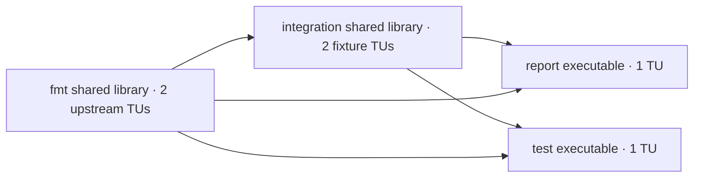

# A bounded real C++ dependency graph

This experiment builds pinned {fmt} 12.2.0 source with a clearly labelled integration fixture. It is a broader language/target graph than the existing single C library experiment; it is not a benchmark of the entire upstream fmt test suite or a general CMake replacement.

The upstream [12.2.0 release](https://github.com/fmtlib/fmt/releases/tag/12.2.0) supplies unchanged `format.cc` and `os.cc`. Its [CMake target](https://github.com/fmtlib/fmt/blob/12.2.0/CMakeLists.txt) identifies these compiled-library sources and shared-library definitions. The source archive is pinned to SHA-256 `8b852bb5aa6e7d8564f9e81394055395dd1d1936d38dfd3a17792a02bebd7af0` from the [upstream tag archive](https://codeload.github.com/fmtlib/fmt/tar.gz/refs/tags/12.2.0).

The graph has four target nodes and six translation units:



The fixture exercises actual fmt formatting, C++ strings, arrays, numeric algorithms, shared-library dependencies and two normal executable processes. Its source/header mutations change observable results. No generated-header claim is made. Compilation uses the same explicit C++17/O2/PIC flags for both engines; independent CLI references verify named public artifacts and intermediate object bytes.

## Controls and boundaries

Ninja+ccache keeps persistent Ninja dependency/command logs and an ordinary object cache. The programmatic adapter uses the existing pinned Odin/Clang host in private per-target resident processes. Independent leaves overlap; no target gets more than four workers and the whole graph stays within eight. Compilation context excludes derived dependency artifacts; linker request/current-result identities include them. Both retain object-history caching within a trace, but neither restores historical whole linked results. The default `--cache-policy baseline-seeded` restores baseline-only compiled-object caches before each timed block; resident input/authentication caches remain warm. `--cache-policy repeated-trace` preserves edited objects across blocks and measures a different history-hit workload.

Actual Clang header search and dependencies are captured. Complete C++/Clang include roots and positive C SDK inputs are admitted to the immutable VFS. Recursive LLD trace and runtime/tool dependencies provide explicit pinned external linker inputs. The wrapper checks source/SDK/link generations before and after every operation on both engines; changed identities are rehashed. This is a trusted local stat-reuse model, not hostile-writer protection or arbitrary SDK namespace-update support.

The current host's handoff hook refuses an external filename ending `.o`. CRT startup objects therefore receive immutable `.input` aliases with the **same bytes**, and those same arguments go to both engines. Independent original-versus-aliased CRT CLI links must produce byte-identical artifacts. Original and admitted copies stay pinned and checked. This documents an existing interface limitation instead of extending the shared backend.

Capture-only preparation needs no actual object compilation:

```sh
python3 -B experiments/compiler/cpp_graph/capture.py \
  --llvm /path/to/llvm --host /path/to/host \
  --blake3-helper /path/to/blake3-helper.so \
  --ninja /path/to/ninja --ccache /path/to/ccache
```

The comparison driver additionally requires `--output /path/to/fresh-results` and accepts `--trials 3` (or `1` for correctness smoke). `--tool-library-path` supports an independently extracted Ninja/ccache installation. Download the pinned archive to ignored `_work/downloads/fmt-12.2.0.tar.gz`, or pass `--archive`. Large work data stays under the ignored folder on the repository filesystem.

```sh
python3 -B -m unittest discover -s experiments/compiler/cpp_graph -p 'test_*.py' -v
python3 -B experiments/compiler/cpp_graph/run_graph.py \
  --llvm /path/to/llvm --host /path/to/host \
  --blake3-helper /path/to/blake3-helper.so \
  --ninja /path/to/ninja --ccache /path/to/ccache \
  --output experiments/compiler/cpp_graph/_work/runs/first --trials 3
```

The whole graph is measured for no-op, implementation edit, used integration-header edit and revert, with a separate clean boundary. Runtime and byte-identity verification are independent checks after each operation; source/SDK/link pre/post validation stays inside the operation clock. Setup, native process residency and clean caches must be interpreted separately from incremental results. Raw observations, source snapshots, tool paths and generated inputs remain ignored; compact human reports are retained for the [baseline-seeded fresh edits](results/baseline-seeded/REPORT.md) and [preserved repeated-history trace](results/repeated-trace/REPORT.md). The seeded comparison is the primary ordinary-edit result; no mixed history-hit median is presented as fresh compilation.
