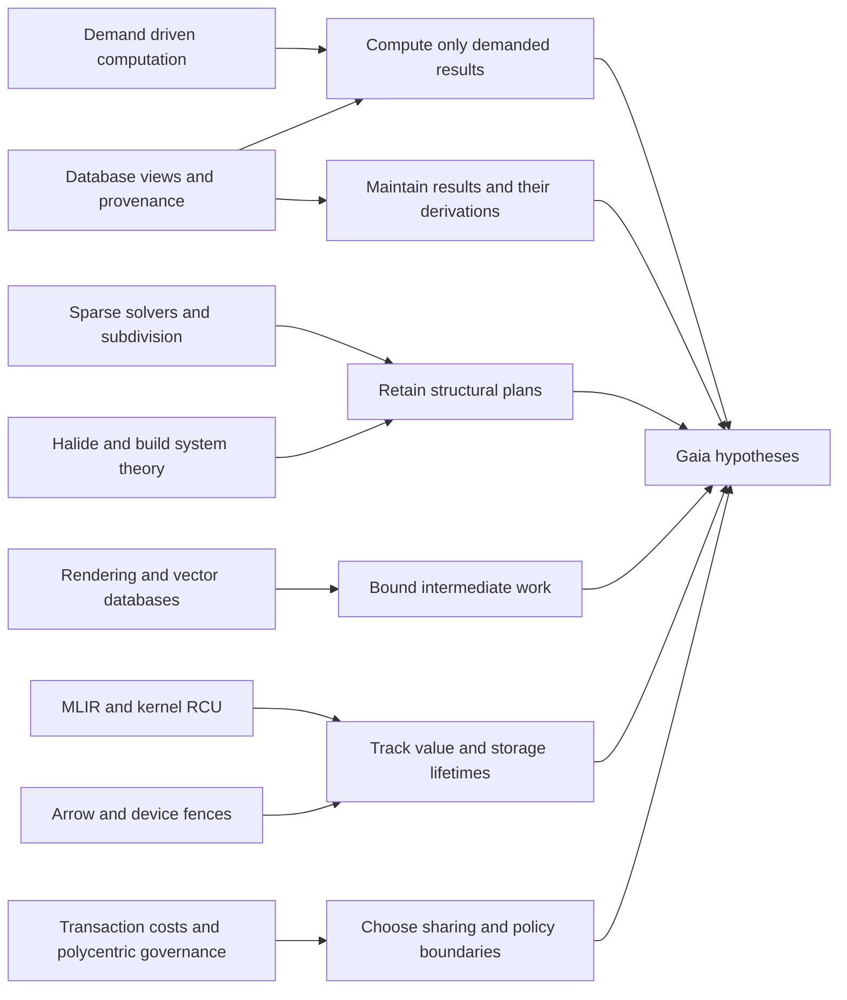

# Connections across the development environment

Start with [what the experiments established](findings.md) and [what to connect next](prospects.md). This track joins ideas from databases, compilers, graphics, numerical methods, device interfaces and runtime isolation to concrete source, build and test operations. Its literature synthesis and measured continuations have different evidential roles.

The central question is what a development environment can retain beyond source bytes and final artifacts: demand, derivations, structural plans, native facts and ownership information. The shared facilities connecting source generations, dependency inputs, tool requests and artifacts are the “substrate” in the [platform direction](../../docs/platform.md). This does not require a universal AST, one execution engine, one process or one storage format.

## Read the measured work

- [Source discovery and validation](discovery-validation.md): three historical Jinja fix replays preserve native selection and reject stale evidence; the added view costs roughly 4–13% over native testmon. Human/agent productivity remains unmeasured.
- [Source deltas and diagnostics](delta-analysis.md): retaining native parser facts and caching consumers cuts the measured trace by 57%; an extra shortest-proof graph adds no established overall benefit.
- [Native references and namespace observations](import-rebinding.md): indexing observed names and absences cuts the tested trace by 42% against full rescans; complete reference retention adds no established gain over scoped native parsing.
- [Prepared runtime and private test resources](branched-tests.md): forked requests preserve heap isolation but establish no robust gain over native database reuse; warm reuse is faster under a narrower contract.
- [Compiler backend policy](backend-policy.md): cheaper machine passes reduce compilation by 17–20% against `-O2`, while stock development settings win the tested complete operations.
- [Retained facts and two consumers](retained-facts.md): compact graphs help traversal but lose after production/invalidation costs against LLVM use lists with equal caching.
- [SSA liveness formulations](pass-experiments.md): equivalent worklist, Boolean-sweep and per-value analyses on upstream LLVM IR, including conversion costs and a negative result for the alternatives.

The [run index](experiments.json) links validation and provenance. The [compiler integration](../integration/generalization/README.md) separately tests frozen reuse and backend scheduling across four upstream projects. These clocks and results are not pooled.

## Read the mechanisms and proposals

- [Twenty two connections](connections.md): mechanism, possible application, analogy limits and an observable question.
- [Research questions](questions.md): combinations to test, strong controls and reasons to stop.
- [Source indexing and discovery](source-discovery.md): text search, incremental structure, contextual bindings, live edits and evidence for humans and agents.
- [Replaceable tool internals](tooling-internals.md): frontends, semantic queries, lint engines, code generation, linking, metadata, runtimes and memory management.
- [Architectural directions](architectural-next.md): detailed motivations and the outcomes of their measured continuations.
- [Accelerators and physical models](development-loop.md): the complete development loop, Linux mechanisms and hypotheses from other fields.
- [Reading routes](sources.md): primary literature and implementation entry points.

## The map

The arrows below are proposed transfers of ideas, not claims of historical influence.

| Connection | Fields joined | Potential saving | Relation to existing Gaia work |
| --- | --- | --- | --- |
| [1 Demand](connections.md#1-demand-is-an-input) | PL research, language servers, interactive tools | Work on outputs nobody currently needs | Extends queued cancellation to demand within a computation |
| [2 Deltas](connections.md#2-changes-can-have-their-own-compiled-programs) | Discrete algebra, databases, repository facts | Repeated evaluation of affected queries | Extends reachability to maintaining derived relations |
| [3 Derivations](connections.md#3-retain-why-a-result-exists) | Provenance, algebra, scientific data | Reconstructing dependencies and explanations | Extends observed-input records with structured witnesses |
| [4 Structure](connections.md#4-separate-structural-plans-from-changing-values) | Sparse numerical methods, subdivision rendering, builds | Repeated structural analysis | Adds a reuse level between exact inputs and final artifacts |
| [5 Schedules](connections.md#5-separate-meaning-from-execution-policy) | Halide, build-system theory | Repeated redesign for each execution strategy | Makes existing scheduling and cache choices independently comparable |
| [6 Equivalences](connections.md#6-optimize-a-small-algebra-of-valid-workflows) | Equality saturation, query optimization | Poor ordering, duplicate conversion, unnecessary materialization | New bounded planner hypothesis |
| [7 Filters](connections.md#7-use-cheap-conservative-filters-before-exact-validation) | Abstract interpretation, collision detection, caching | Expensive candidate validation | Responds to unsafe AST fingerprints without promoting them to proofs |
| [8 Views](connections.md#8-a-shared-view-may-need-a-private-complement) | Bidirectional transformations, schema adapters | Repeated decoding with exact regeneration | Extends the existing explicit/default/unknown-field result |
| [9 Batches](connections.md#9-unify-a-bounded-working-representation) | Reyes, vectorized databases | Large intermediate objects and per-item overhead | Refines shared representations around a bounded working set |
| [10 Storage](connections.md#10-value-lifetime-and-storage-lifetime-are-different) | Compiler bufferization, RCU, generations | Copies, per-read coordination, excessive retention | Extends leases to logical values versus physical allocations |
| [11 Handoffs](connections.md#11-a-buffer-handoff-is-an-ownership-and-completion-contract) | Arrow, DMA, asynchronous devices | Marshalling and repeated admission | Adds completion and memory-domain semantics to shared bytes |
| [12 Events](connections.md#12-amortize-event-handling-with-bounded-service) | Network drivers, asynchronous I/O, tool services | Syscalls and wakeups | Extends fixed batching with an explicit fairness budget |
| [13 Ownership](connections.md#13-move-small-requests-to-owned-state) | SPDK, actor systems, cache locality | Shared mutable-state contention | Alternative to one globally locked catalogue |
| [14 Fairness](connections.md#14-allocate-resource-vectors-instead-of-worker-slots) | Resource economics, cluster schedulers, local tools | Oversubscription and interference | Extends soft memory gates beyond a single scalar |
| [15 Placement](connections.md#15-model-shared-inputs-as-hyperedges) | Hypergraph partitioning, scientific computing, packages | Replication and repeated input movement | Alternative to force layouts and pairwise co-access clustering |
| [16 Sparse kernels](connections.md#16-share-sparse-kernels-without-erasing-edge-meaning) | Semirings, GraphBLAS, dependency analysis | Pointer chasing and repeated graph kernels | Strong CPU baseline before further accelerator claims |
| [17 Hierarchies](connections.md#17-optimize-movement-at-each-memory-level) | I/O complexity, Roofline, hardware caches | Cache misses and memory traffic | Separates byte sharing from efficient byte access |
| [18 Reclamation](connections.md#18-group-persistent-data-by-lifetime-as-well-as-access) | SSD translation layers, garbage collection, artifact storage | Copying live data during reclamation | Adds write amplification to pack-layout questions |
| [19 Integration](connections.md#19-treat-integration-as-a-marginal-cost-decision) | Transaction-cost economics, systems architecture | Repeated boundary crossings | Provides a way to judge how much to unify |
| [20 Local policy](connections.md#20-share-accounting-while-leaving-policy-near-consumers) | Polycentric governance, exokernels | Poor global decisions and resource externalities | Architectural analogy for specialized policies under shared limits |
| [21 Preparation](connections.md#21-preparation-has-an-option-value-and-an-expiry-risk) | Investment reasoning, caching, online decisions | Preparation that never amortizes | Extends existing producer-cost accounting to invalidation risk |
| [22 Residency](connections.md#22-offload-a-resident-pipeline) | Wavefront rendering, GPU execution, dataflow | Repeated transfers and synchronization | Changes the question after the measured GPU traversal loss |

## What is new relative to the theory track

The [existing theory](../theory/README.md) and [science coverage](../science/coverage.md) already cover set reconciliation, patch laws, fixed points, pebbling, queueing, feedback, reinforcement, geometry and heterogeneous execution. This pass adds particular mechanisms and combinations: demand-sensitive views; derivation annotations; structural plans; bounded working representations; completion-aware ownership; hypergraph communication models; lifetime-aware reclamation; and economic limits on integration.

The strongest near-term questions are **shared demanded facts**, **structural reuse**, and **precise ownership across consumers**. With the expanded scope, source discovery plus a genuine diagnostic/compiler consumer is the preferred concrete way to investigate them. This ranking reflects fit to Gaia's existing evidence and the availability of useful controls, not a forecast of speedup. The more speculative algebraic planner and institutional analogies should remain independent research directions.

The earlier negative results still matter: fixed batching, ordinary clustering, native sparse traversal and mature combined APIs are controls to preserve. A connection is useful even when it explains why a proposed optimization should lose.
