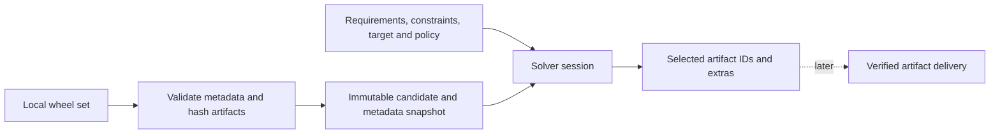

# Python research design: local dependency resolution

Classification: **Python-specific dependency-resolution research**. This document preserves the query/source contracts. Start with the [current review](../resolution.md), [evidence register](../experiments.json), and [follow-up queue](../follow-up.md). Dependency loading/application startup is a [separate Python track](../dependency-formats.md).

Status: a local Python-ecosystem reference provider, benchmark and correctness suite are implemented. [Measurements and findings](../../../experiments/python/dependency_solving/FINDINGS.md) compare metadata delivery, caching and a generic decision-order heuristic. No repository server, remote protocol, installer or native solver is implemented. Native implementation components in the broader effort remain Odin.

The prior loader experiment mainly changed how pip's own implementation was loaded. It left pip's candidate-wheel metadata access and dependency-solving machinery on their existing paths. Complete pip process time therefore could not establish a generic solver or metadata-access floor. This experiment isolates those costs while retaining a single resolvelib implementation across comparisons.

## Local input and query boundaries

Admission records normalized project identity, version/build/tag declarations, artifact byte identity, static dependency metadata and metadata identity. The snapshot ID is content-derived and excludes physical file locations. The consumer pins its admitted inventory/catalog digest. Local file locations remain a separate implementation map, included in the experimental JSON documents for convenience.

The initial source interface is `list_candidates(project)` and `metadata(artifact_id)`. This lets a directory of wheel files, a metadata cache or one precomputed catalog feed the same solver. Full package bytes need not be transferred/read by the solver once metadata has been certified. Later artifact delivery must independently verify bytes against the selected artifact ID. This work does not define trust/signing policy for a remote producer.

A query supplies named requirements, optional constraints, a complete target marker environment, ordered compatible tags and explicit prerelease policy. Results distinguish a validated solution, resolver-reported unsatisfiability, and an incomplete round-limit outcome. Extras and conditional dependencies are evaluated within the target context. The implementation is Python-specific; another ecosystem needs its own version/requirement/feature semantics adapter rather than inheriting Python rules.

## Controls and optimization axes

The same finite package universe is used across wheel-file, session-cached and catalog sources. The original 22 wheel artifacts are byte-identical to the previous pip experiment and select the same versions in a fresh offline pip reference run. Additional generated inventories isolate breadth, repeated shared constraints, conflicts and unsatisfiability. A custom local wheel directory and requirements can replace them without changing resolver code.

Storage comparisons keep candidate ordering and solver implementation fixed. Additional variants separately cache parsed predicates/candidate matches and then change decision order to prefer the smallest known candidate set. Cache keys bind the immutable snapshot, target, options, constraints and incompatibilities. Repeated runs start a new solve and do not reuse a complete solution. Successful dependency closures are independently validated outside timing; small tests also compare with exhaustive finite outcomes.

The [incremental follow-up](../../../experiments/python/dependency_solving/FINDINGS.md#incremental-scheduling-follow-up) separately changes scheduling while keeping the cached baseline's lexical order and exact inputs. A pending-criterion heap replaces repeated full satisfaction/preference scans; changed constraints invalidate affected pins, and rollback rebuilds the queue conservatively. The adapter preserves the pinned upstream core's candidate validation/backjumping and still copies full states. It is a tested Python/private-core experiment, not a native solver or a generic extension for dynamic preference policies.

The [trail follow-up](../../../experiments/python/dependency_solving/FINDINGS.md#reversible-state-follow-up) replaces those full map copies with reversible mutations and constant-size version handles. Candidate attempts use an overlay and publish only changed criteria; historical branches restore values and insertion order through undo/redo. Increasing conflict-free graph sizes measure whether this removes quadratic copy growth. Conflict scans, repeated constraint-information lists and hard search remain separate costs; general dependency resolution does not acquire a polynomial-time guarantee.

The reference provider currently checks candidate eligibility eagerly, including Requires-Python. It is not pip's exact lazy-candidate/preparation policy. Candidate summaries carrying eligibility information and deferred candidate preparation are future local experiments. The benchmark is a controlled reference, not a claim that pip repeats every operation in its uncached control.

Consumer timings separate library bootstrap, source/catalog open, first solve and repeated solves within a session. Metadata time is an included subset of solve time. One-time admission/hashing and index sizes are reported separately; a one-use scenario must include admission cost. Metadata caches assume a fixed snapshot/session. Cache entry counts are recorded; a production memory/eviction policy is not yet chosen.

The [naive/startup comparison](../../../experiments/python/dependency_solving/results/naive-startup/REPORT.md) additionally measures the original uncached control at larger graph sizes and reruns the original pip loading experiment alongside single-use reference-solver processes. This distinguishes algorithmic gains from command startup and preserves the narrower semantics of the reference provider. Real pip is compared on its original byte-identical 22-wheel set, not inferred from the generated wide-graph ratios.

The [published Django follow-up](../../../experiments/python/dependency_solving/FINDINGS.md#published-django-candidate-sets) tests a pinned 15-wheel candidate universe and matches every selected artifact hash with fresh offline pip reports. Core/REST queries select three/five distributions, while the separate application imports hundreds of modules. Metadata catalogs remove repeated wheel ZIP setup; those solve timings are separate from framework initialization and first responses. The limited candidate corpus is not a complete ecosystem-scale resolution test.

## Compatibility and deliberate limits

Supported inputs are static local wheels and named PEP 508 requirements, PEP 440 versions/specifiers, extras, standard environment/extra markers, Requires-Python and explicit tag/prerelease policies. Build/ABI preference is documented by the reference provider; this is not a drop-in replication of every pip preference or error behavior. Direct URL/VCS requirements and dynamic dependency metadata are rejected. Source builds, installed-state preference, yanked index data, pip command-line/config directives, artifact installation and network discovery are outside this slice.

The JSON encoding, snapshot canonicalization and one-filename-per-byte-identity restriction are experimental. Duplicate identical candidate identities can collapse, but conflicting filename identities for the same bytes currently fail admission. These choices must not be treated as a stable remote repository schema. The useful future protocol boundary is immutable candidate/metadata identity, explicit query context and bulk access capabilities, with independently verified artifact bytes delivered afterward.

See [reproduction and custom-input instructions](../../../experiments/python/dependency_solving/README.md), [implementation](../../../experiments/python/dependency_solving/solver.py), and [initial report](../../../experiments/python/dependency_solving/results/initial/REPORT.md).
